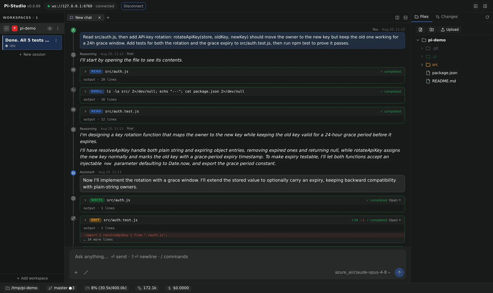
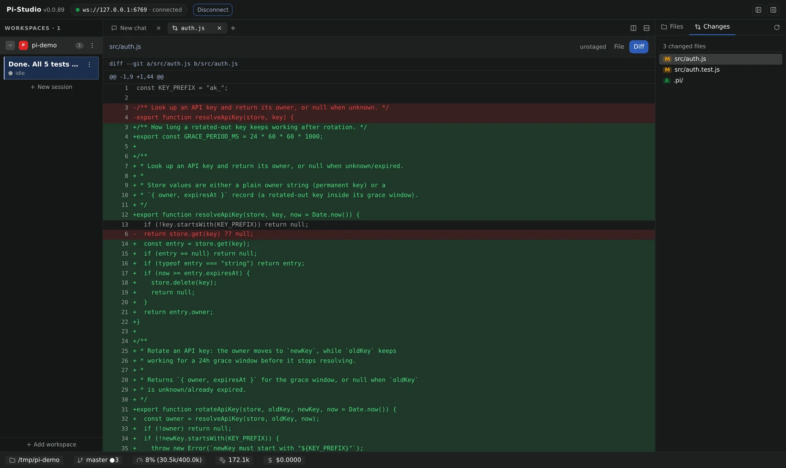
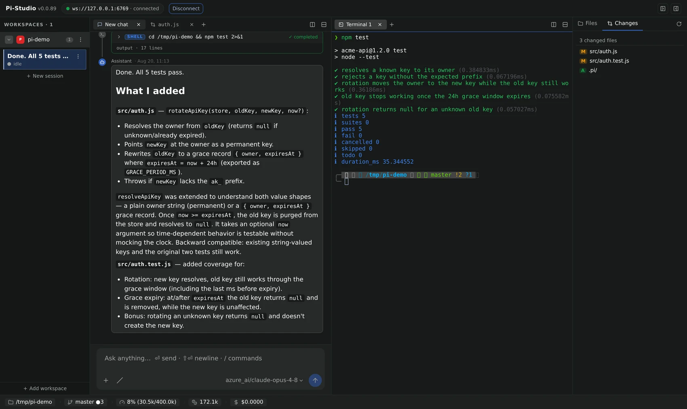
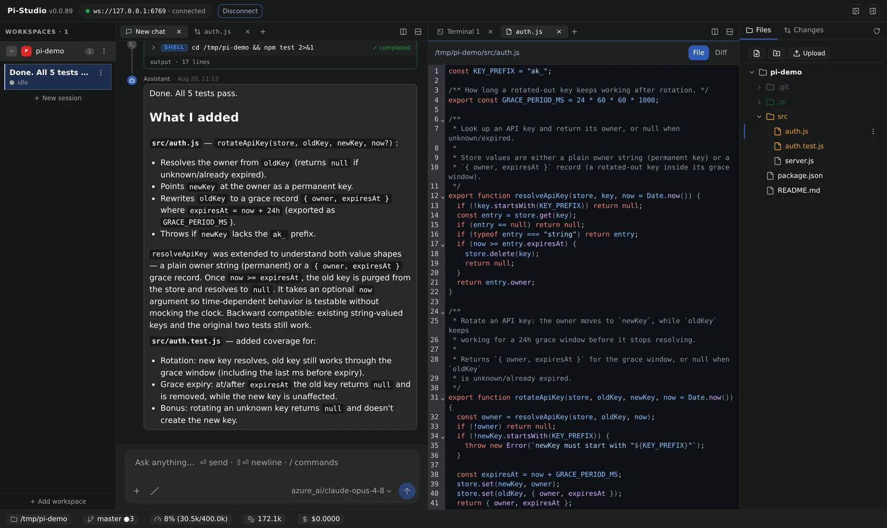
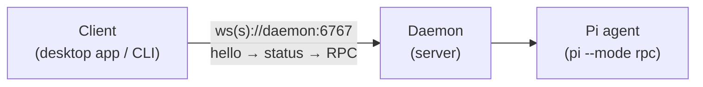
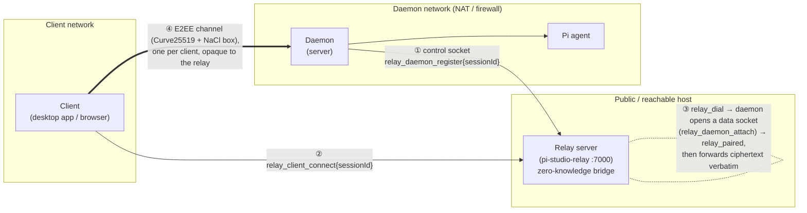

# Pi-Studio

Pi-Studio drives [**Pi**](https://pi.dev) — the terminal coding agent by Earendil — **locally or
remotely**. A long-lived daemon runs on your machine, or on a server you own, and manages agent
processes, terminals, git worktrees, and projects. **Pi Studio Desktop**, a native app for macOS,
Linux and Windows, is the main way to use it: it runs the daemon for you and connects to daemons on
other machines. A CLI and a browser client talk to the same daemon.

**[Download Pi Studio Desktop](https://github.com/avatsaev/pi-studio/releases/latest)**

| System                          | Installer                     |
| ------------------------------- | ----------------------------- |
| macOS (Apple Silicon and Intel) | `.dmg` (universal)            |
| Windows (x64)                   | `-setup.exe` or `.msi`        |
| Linux (x64)                     | `.deb`, `.rpm` or `.AppImage` |

<p align="center">
  
</p>

---

## Pi Studio Desktop

1. **Install it.** Take the installer for your system from the
   [latest release](https://github.com/avatsaev/pi-studio/releases/latest). The builds are not signed with a
   real identity, so the system warns before the first open: on macOS allow the app in System Settings →
   Privacy & Security; on Windows choose "More info", then "Run anyway" in the SmartScreen dialog.
2. **Open it.** On macOS and Linux the app downloads its own `pi-studio` daemon the first time it needs one
   (one executable, checked against the SHA-256 the app was built with) and starts it. There is no Node, npm
   or CLI to install. Windows has no local daemon: add a daemon on another machine or in WSL2 instead
   (see [Connect to any daemon](#connect-to-any-daemon)).
3. **Log in to a model provider.** Settings (the gear) → Model Providers. The credential is written on the
   daemon's machine, where the agents read it.
4. **Open a workspace**, a project folder on the daemon's machine, and start a session.

What the app does that a browser tab cannot:

- **It runs the daemon.** It installs, starts and updates the daemon on this machine and, from its Daemons
  screen, on an SSH host. Quitting the app does not stop the daemon, so agents keep working.
- **It keeps secrets out of the page.** Passwords, pairing links and SSH passphrases are in the system's
  keychain (macOS Keychain, Windows Credential Manager, the Secret Service on Linux), or in a file only you
  can read when there is none.
- **It moves large files.** Uploads and saves go between the disk and the daemon without passing through the
  page: up to three at once, each with a percentage and a Cancel button, and one that loses its connection
  continues by itself.
- **It updates itself.** It checks at launch and once a day ("Check for Updates…" is in the menu), and a
  build is offered only after it passed an update check on all three systems.
- **It can put `pi-studio` on your `PATH`** (`~/.local/bin/pi-studio`, from the settings on the Daemons
  screen; macOS and Linux).

### Connect to any daemon

The Daemons screen keeps a list of daemons and the app opens on the one used last. There are four kinds:

| Kind         | What it reaches                                                        | What it needs |
| ------------ | ---------------------------------------------------------------------- | ------------- |
| This machine | The daemon the app runs locally (macOS and Linux)                      | Nothing |
| SSH          | A daemon on a Linux or macOS host you can `ssh` into, through a channel of the SSH connection | No open daemon port. It reads `~/.ssh/config` and logs in through jump hosts with the agent, key files or a password. When the daemon there is missing, stopped or too old, the screen offers Install, Start or Update |
| Address      | A daemon at `host:port`                                                | The daemon's password when it listens beyond loopback |
| Relay        | A daemon behind NAT or a firewall, through the [E2EE relay](#optional-e2ee-relay-reaching-a-daemon-behind-natfirewall) | A pairing link from `pi-studio daemon pair` |

## The workspace

Every tool call an agent makes (read/edit/write/shell) renders as its own card, with live diff
stats, right in the chat — that's the screenshot above. Review what it changed without leaving the
window:

<p align="center">
  
</p>

Split the workspace into multiple panes — chat next to a live terminal (backed by `node-pty`), a
file, or another session — and the layout is kept per workspace:

<p align="center">
  
</p>

Every file opens with full syntax highlighting:

<p align="center">
  
</p>

## The CLI

`pi-studio` is the daemon's command line, for servers, scripts and staying in the terminal: it starts and
stops daemons and drives agents.

```bash
npm install -g @av-pi-studio/cli
```

**Single binary.** Every release also publishes `pi-studio` as one executable per system (macOS arm64 and x64,
Linux x64 and arm64) on the `daemon-v<version>` GitHub releases: the CLI, the daemon, Pi and the `skills` CLI
together, with no Node needed. It is the binary the desktop app installs. The Linux binaries need glibc 2.17
or newer (CentOS 7 works; Alpine does not). `git` must be on the machine for `skills add owner/repo` and
`pi install git:…`.

```bash
# log in to a model provider (the `pi` provider needs one before it can run a turn)
pi-studio auth login

# start a local daemon (if one isn't already running) and print a pairing QR code
pi-studio daemon start

# run an agent, list it, attach to stream live output
pi-studio agent run --provider pi/claude-3-5-sonnet "implement user authentication"
pi-studio agent ls
pi-studio agent attach <agentId>

# target a remote daemon instead of the local one
pi-studio --host workstation.local:6767 agent ls
```

A machine has one daemon, shared by the CLI and the app: a daemon started from a terminal is the one the
app's "This machine" entry opens.

Run `pi-studio --help` (or `<command> --help`) for the full command tree, and see
[`packages/cli/README.md`](packages/cli/README.md) for the complete CLI reference — every command
group, global option, and the library API.

## In a browser: Pi Studio Lite

The browser client ("Pi Studio Lite") shows the same workspace in a tab, for a machine where you cannot
install the app. It connects only through the [E2EE relay](#optional-e2ee-relay-reaching-a-daemon-behind-natfirewall),
with a pairing link: it has no address or password field, and the daemon refuses a browser that dials its
port directly. Point the daemon at a relay, run `pi-studio daemon pair` and open the printed link (or scan
the QR code). The CLI does not serve the browser client; to host your own, see [Docker](#run-with-docker).

---

## Daemon configuration

The daemon reads `$PI_STUDIO_HOME/config.json` and these environment variables — set them before
`pi-studio daemon start`, or pass them to `docker compose` (see [Docker](#run-with-docker) below).
The desktop app starts its daemon in your login shell's environment, so a variable exported in your
shell profile applies there too. All are optional.

| Variable                   | Default                 | Purpose                                                   |
| -------------------------- | ----------------------- | --------------------------------------------------------- |
| `PI_STUDIO_HOME`           | `~/.pi-studio`          | State + config + logs directory                           |
| `PI_STUDIO_LISTEN`         | `127.0.0.1:6767`        | Daemon listen address (`host:port`); also `config.json` `daemon.listen`. Use `0.0.0.0:6767` + `PI_STUDIO_PASSWORD` for LAN access (a non-loopback bind without a password is refused) |
| `PI_STUDIO_PASSWORD`       | _(unset)_               | Require this password for connections (bcrypt-checked)    |
| `PI_STUDIO_HOSTNAMES`      | `localhost,*.localhost` | Allowed `Host` header values (literal IPs always allowed) |
| `PI_STUDIO_SERVER_ID`      | _(generated UUID)_      | Stable server identity                                    |
| `PI_STUDIO_LOG_LEVEL`      | `info`                  | pino log level                                            |
| `PI_STUDIO_RELAY_ENABLED`  | `false`                 | Opt in to dialing out to a relay (see below)              |
| `PI_STUDIO_RELAY_ENDPOINT` | _(unset)_               | Relay `host:port` to dial                                 |
| `PI_STUDIO_RELAY_USE_TLS`  | `false`                 | Use `wss://` to reach the relay                           |

Example — run on a different port with a password and an isolated home:

```bash
PI_STUDIO_HOME=/tmp/pi-studio-dev \
PI_STUDIO_LISTEN=127.0.0.1:6790 \
PI_STUDIO_PASSWORD=hunter2 \
pi-studio daemon start
```

A password can also be set on an already-running daemon: `pi-studio daemon set-password hunter2`
(bcrypt-hashed into `config.json`, enforced on next start). To revoke every pairing link/QR ever
issued (e.g. one leaked), mint a fresh keypair: `pi-studio daemon rotate-key`.

### Updating the daemon

Any connected client can update a daemon that was installed with `npm i -g @av-pi-studio/cli` or that is the
single binary (the desktop app's, or one downloaded from a `daemon-v*` release): the app and the browser client show a "Daemon X"
pill when a newer version is available (npm for the package, the `daemon-updates` release of this repository for
the binary; checked at start, every 6 h, and when a client connects whose last check is over 10 minutes old; Settings → Daemon has "Check now" and a switch, or set
`PI_STUDIO_UPDATE_AUTOCHECK=false`). The desktop app's Daemons screen offers Update for a local or SSH daemon that
is stopped or too old; it installs the binary the app was built with. The update installs the new
version, restarts the daemon on the same address, and puts the previous version back if the new one does not
start (a version that was rolled back is not offered again until a newer one appears); clients reconnect by
themselves. A daemon in Docker, a source checkout, a read-only npm folder, a binary run from outside
`$PI_STUDIO_HOME/bin/versions/` or Windows does not update itself and says which command to run. From a
terminal, `pi-studio update` updates the CLI or the binary and restarts a running local daemon
(`PI_STUDIO_DAEMON_UPDATE_URL` points a binary at another release channel; for tests and private mirrors).

## Optional: E2EE relay (reaching a daemon behind NAT/firewall)

By default a client connects **directly** to the daemon's WebSocket. When the daemon can't accept
inbound connections (behind NAT, no port-forward), the `@av-pi-studio/relay` package provides an
end-to-end encrypted rendezvous: the daemon dials **outbound** to a relay, the client connects to the
same relay, and all application traffic is encrypted with Curve25519 ECDH + XSalsa20-Poly1305 (NaCl
`box`). The relay is **untrusted and zero-knowledge** — it forwards ciphertext frames verbatim, keyed
by session id, and never sees message contents, only metadata.

The relay is **fully opt-in**: with `daemon.relay.enabled` unset (default `false`), the daemon behaves
exactly as if the package weren't installed.

### Simple setup — direct connection (default, no relay)

The client reaches the daemon's WebSocket directly. Nothing extra to run.



### Scaled setup — client → relay → daemon (daemon behind NAT)

The daemon dials **outbound** to the relay (so no inbound port is needed on the daemon's network):
it keeps one control socket open and, for each client connection, opens a separate data socket. The
client dials the relay with the same `sessionId`; the relay pairs that one client socket with one daemon
data socket and blindly forwards frames, so up to **32 clients** can use one daemon at once. The E2EE
channel is established **end-to-end between client and daemon**, so the relay never holds decryptable
traffic.



Handshake order over the relay (protocol 2): the daemon registers a control socket with
`relay_daemon_register{sessionId}` → a client sends `relay_client_connect{sessionId}` → the relay sends
`relay_dial{connectionId}` on the control socket → the daemon attaches a data socket with
`relay_daemon_attach{sessionId, connectionId}` → the relay sends `relay_paired` to both. Those first
frames are JSON; **after `relay_paired` every frame is binary**: the client sends the channel `hello`
(its fresh public key), the daemon answers `ready` (a daemon salt plus an encrypted confirmation), and
all further traffic is NaCl-box ciphertext with counter nonces. Only **after** the channel is up does the
normal `hello → status → RPC` protocol run inside it. The relay refuses a connection with a close code
(4100–4109; `daemon_offline`, `daemon_unresponsive`, `too_many_clients`, `daemon_outdated`, …) that the
client SDK reports as a `RelayConnectError` with a reason; the whole client connect is limited to 15 s.
The relay applies flow control (pause above 1 MiB queued, resume at 256 KiB) and pings every socket every
30 s, so one slow client cannot make the relay or another client's connection wait.

> **Upgrading from relay protocol 1 (0.0.120 and earlier).** The daemon must be updated: an old daemon
> still registers with `relay_register`, the relay parks that socket, and a new client sees
> `daemon_outdated` instead of a connection. Browser tabs opened before the update stay on "connecting"
> until they are reloaded. Existing pairing links stay valid — the daemon key and the session id derived
> from it do not change. A self-hosted relay must be updated too.

### Running a relay + pointing a daemon at it

```bash
# 1) start a relay on a reachable host (defaults to 0.0.0.0:7000)
npx @av-pi-studio/relay --listen 0.0.0.0:7000
# or via the CLI, managed as a local process:
pi-studio relay start --listen 0.0.0.0:7000

# 2) point the daemon at it (config.json)
#    { "daemon": { "relay": { "enabled": true, "endpoint": "relay-host:7000", "useTls": false } } }
#    or env: PI_STUDIO_RELAY_ENABLED=true PI_STUDIO_RELAY_ENDPOINT=relay-host:7000
```

The client then pairs via a pairing link (carrying the daemon's public key + relay session id) from
`pi-studio daemon pair`: add it in the desktop app as a "Relay (pairing link)" daemon, or open it in a
browser. In the SDK it swaps in the relay transport — every other `DaemonClient`/`PiStudioClient` API
works unchanged. See [`packages/relay/README.md`](packages/relay/README.md) for the full protocol and
library API.

> **Treat a pairing link like a password.** On a relay connection its `offer=` key *is* the
> credential, and the relay session id is derived from that key — so a leaked link keeps working
> until the key is replaced. Run `pi-studio daemon rotate-key` to revoke it: the daemon mints a new
> keypair, restarts, and prints a fresh QR (all clients must re-pair; your password and relay
> settings are untouched).

## Run with Docker

Prebuilt Dockerfiles + compose for the daemon, relay, and web UI live in [`docker/`](docker/). The
daemon image ships `git` + a compiled `node-pty` + the bundled `pi` runtime; the relay image is a
tiny pure-JS stateless bridge; the web-client image is the static React/Vite SPA served by nginx.
All build from local monorepo source.

```bash
cd docker
PI_STUDIO_PASSWORD=choose-a-password docker compose up --build   # relay :7000 + daemon :6767 + web UI :8080; the password is required
```

Then add it in the desktop app as an "Address" daemon (`localhost:6767`, with the password), or drive it
from the CLI: `pi-studio --host http://localhost:6767 --password "$PI_STUDIO_PASSWORD" ls`.
The browser client connects through the relay only, with a pairing link (see [`docker/README.md`](docker/README.md)
for generating one). Mount your
projects at `/workspace` (`PI_STUDIO_PROJECTS=/abs/path`), persist state in the `/data` volume, and
supply pi credentials via `ANTHROPIC_API_KEY` or a mounted `auth.json`. See
[`docker/README.md`](docker/README.md) for the full env/volume/auth/security matrix.

## The `pi` provider

The `pi` CLI is **bundled** with the daemon (`@earendil-works/pi-coding-agent`; the daemon launches it
as `pi --mode rpc`), so **no global `pi` install is required**. You only need pi _authenticated_: in the
desktop app, Settings → Model Providers; from a terminal, `pi-studio auth login` (see below);
alternatively set `ANTHROPIC_API_KEY` (etc.) in the daemon's environment.

```bash
pi-studio auth login                          # interactive: pick a provider, enter a key
pi-studio auth login openai --api-key sk-...  # headless, for scripts/CI
pi-studio auth status                         # what's configured, and from where
```

This writes Pi's own credential store (`~/.pi/agent/auth.json` by default, or
`<dir>/agent/auth.json` under `--pi-home <dir>`) — the exact file the daemon's spawned agents
read, so a credential is picked up on the next agent spawn with no daemon restart. The command is
entirely local: it never connects to a daemon.

To use a _different_ pi than the bundled one, point the daemon at an absolute path in
`$PI_STUDIO_HOME/config.json`:

```json
{ "agents": { "providers": { "pi": { "command": ["/abs/path/to/pi", "--mode", "rpc"] } } } }
```

A missing/unresolvable pi surfaces as a clean `rpc_error` ("Pi provider unavailable…") instead of
crashing the daemon. The daemon speaks the real Pi RPC protocol (strict JSONL): a `create_agent` with
the `pi` provider runs an actual model turn and streams `assistant_message` deltas, tool calls, and
`turn_completed`. A literal `~` in the `cwd` field is expanded to your home directory. For a
dependency-free smoke test, use the `mock` provider instead.

## More

- The desktop app's source, build and design: [`desktop/README.md`](desktop/README.md),
  [`desktop/docs/architecture.md`](desktop/docs/architecture.md)
- Full CLI command reference and library API: [`packages/cli/README.md`](packages/cli/README.md)
- User-facing docs site (Fern) source: [`fern/`](fern/) — preview with `cd fern && fern docs dev`
- Building from source, running tests, and the monorepo layout:
  [`CONTRIBUTING.md`](CONTRIBUTING.md)
- Architecture and feature specs: [`swe/`](swe/) — [`MAIN-SCOPE.md`](swe/MAIN-SCOPE.md) is the
  entry point. Each package also has its own `README.md` and `AGENTS.md`.
