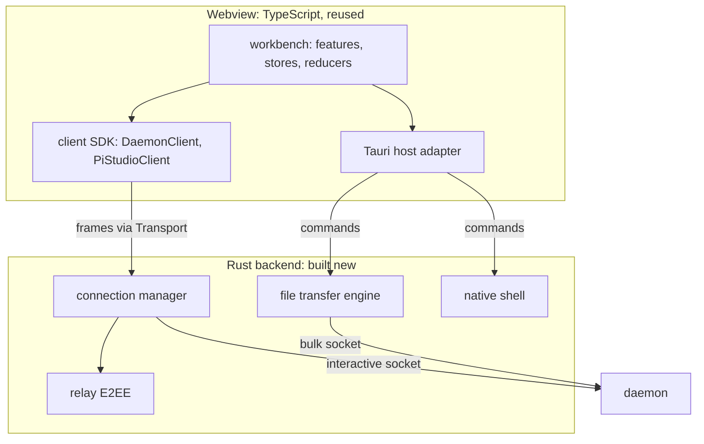

# Desktop client handoff

Onboarding notes for the agent building **Pi Studio Desktop** (`desktop/` in this repository; until
2026-11-15 a separate repository, `pi-studio-desktop`): a Tauri app with a Rust backend and a web UI.
This document says what to reuse from the rest of this repository, what to build in Rust, and why.

Written 2026-11-14 against pi-studio `0.0.117`. Everything under "exists today" was checked against
the code at that version. Anything marked **planned** or **unverified** was not.

**This document is kept current.** The workbench is built in this repository, and every task in
that plan updates this file when it changes something stated here. "Plan and progress" below shows
how far that work has got. Last updated: 2026-11-15 (sprints 091–098 done: 091–095 on `feat/workbench`
(`packages/workbench` is a publishable library with a final public API, a README, a release runbook
and a packed-tarball smoke test; the first npm release happens when the branch merges to `main`),
096 on `feat/desktop-protocol-followups`, stacked on it, 097 and 098 on `feat/desktop-protocol-followups-2`.
Changes from 096 are marked "0.0.118" and from 097 and 098 "0.0.119": the first versions that carry them).

## Status of the pieces

| Piece | State |
|---|---|
| `@av-pi-studio/protocol`, `client`, `relay` | Published on npm, in use |
| `@av-pi-studio/ui-library` (tokens, themes, primitives) | Published on npm since `0.0.117` |
| Workbench package `@av-pi-studio/workbench` | **Built on `feat/workbench`; first npm release when that branch merges to `main`** (sprints 091–095). Contract: `packages/workbench/README.md` (trust it over this document), specified in `swe/architecture/workbench-package.md` and `swe/architecture/workbench-host-adapter.md`. Until the release you can consume it from a packed tarball (`packages/workbench/scripts/pack-smoke.sh` shows how) |
| Protocol follow-ups for this client | **Done on `feat/desktop-protocol-followups`** (sprint 096; stacked on `feat/workbench`, so merge that first; first carried by `0.0.118`): `hello.platform`; daemon-side download pacing, session-owned upload streams, `Error` without `End`; `fileTransferAck` + `file_upload_complete`; SDK paced upload with progress/abort; the browser host's streaming upload; JSON and binary fixtures for file transfer and terminals; the dev daemon serves file transfer and terminals. Spec: `swe/features/desktop-client-protocol-followups.md`. **Second round, download half, done on `feat/desktop-protocol-followups-2`** (sprint 097; first carried by `0.0.119`): download by path with ranges, `ifUnchanged`, cancel and per-session stream ids; the token flow removed; fixtures `formatVersion` 2. **Second round, rest, done on the same branch** (sprint 098; first carried by `0.0.119`): `hello.agentStreams` (`all`/`none`) and `--json` for `pi-studio daemon start|restart|pair|stop`. Spec: `swe/features/desktop-client-protocol-followups-2.md` |
| Desktop client (`desktop/`) | In this repository since 2026-11-15 (branch `feat/desktop-client`). **Milestone 1 is done for Linux** (sprints 102–111, checked live on Linux 2026-11-20; on macOS and Windows only the automated platform checks have run, 2026-11-20). `desktop/apps/pistudiodesktop` mounts `<Workbench>` with a desktop host (`platform: "desktop"`), consuming the monorepo packages from source through Vite aliases; the webview still opens the WebSocket itself. **Storage is in Rust:** the page calls `boot` (stored workbench keys, registry view, preview kind) and `storage_set` for every write; the engine writes `settings.json` (with the app-wide keys such as the theme), `daemons.json` and `daemon-state/<entry>.json` (one layout per daemon entry) in the configuration directory (`--config-dir`). **Dialogs, links and save are native:** confirm/alert are native dialogs, links go to the system opener after a Rust check (http, https, mailto), and save-to-disk asks with the native save dialog and streams 8 MiB ranges into a temporary file beside the destination (1 GiB in 6.5 s, memory flat); closing the window during a transfer asks first. **The HTML preview has its own origin** (`pi-preview://localhost/<id>`): its scripts run and it cannot reach the app (Linux `origin`; macOS and Windows `inert` until measured). **Daemon registry and local daemon:** Rust owns `daemons.json` (mode 0600) and a supervisor that runs the installed `pi-studio` CLI (`daemon status\|start\|restart\|stop`; first start measured at 1.2–2.1 s); the window opens on the last-used entry, a native Daemons menu and the workbench's switcher and Daemons screen switch, add, edit and remove entries (a secret is never read back to the page), per-entry layouts do not mix, and quitting leaves the daemon and its agents running. The page can call only the commands in `desktop/docs/architecture.md` § The webview boundary (no plug-in permission), cannot navigate off the app origin, and a second launch focuses the first window. Checked on Linux in the real webview (WebKitGTK, origin `tauri://localhost`): connect, chat, terminal, code, image, video, PDF and molecule views. The Content-Security-Policy and the reason for each source are in the same section. **Open:** macOS and Windows (the list is `desktop/docs/platform-checks.md`; sprint-106/task-002 and sprint-111/task-002 wait for a person with those machines); on Linux, the Upload picker and a file dragged from the OS (not verifiable in the headless container), a real Node version manager finding the CLI, a relay link whose daemon key was rotated (it reports `daemon_offline`, not `wrong_key`, so the entry is not marked; Replace link works), and the close-time layout flush (a change in the last ~250 ms before closing the window is lost). Its gate is `cargo xtask ci`, run inside `desktop/` |
| `pi-studio-dashboard` | A throwaway test application (owner, 2026-11-21). Nothing is taken from it or shared with it; ignore the mentions of it below |

## Plan and progress

This document is updated by every task that changes something it states. The table is the quick
way to see what you can rely on today. Plan of record: `swe/sprints/PLAN.md`.

| Sprint | Delivers | What it unlocks for the desktop app | State |
|---|---|---|---|
| 091 | Packaging spike, empty `@av-pi-studio/workbench` | Nothing yet | **Done** (on `feat/workbench`; findings in `swe/notes/workbench-packaging-spike.md`) |
| 092 | Application code moved into the workbench; `electron` target removed | Nothing yet (not released) | **Done** (parity: identical bundle, tests, browser check — `swe/notes/workbench-baseline.md`) |
| 093 | Host adapter: storage, clipboard, dialogs, links, launch, transport factory, timers, files, pdf.js | The seam a Tauri host implements | **Done** (contract in `packages/workbench/src/host/types.ts`; a test fails if browser APIs reappear outside the browser host) |
| 094 | Published build, public API, packed-tarball smoke, package README | An importable package and its real API | **Done** (API and host contract: `packages/workbench/README.md`; `scripts/pack-smoke.sh` installs the tarballs into a scratch Vite app) |
| 095 | Release wiring (`scripts/publish.sh` order, `packages/workbench/RELEASING.md`, dry-run rehearsal in a throwaway worktree), repo docs | **Milestone 1 can start** once the branch is merged and released | **Done** on `feat/workbench` (merge and release pending the npm Trusted Publisher registration) |
| 096 | `hello.platform`, paced transfers, upload acknowledgement, file and terminal fixtures (JSON and binary) | A pinned wire contract for the Rust transfer engine (milestone 3) | **Done** on `feat/desktop-protocol-followups` (merge after `feat/workbench`; the next release, 0.0.118, carries it). Live-checked against an isolated production daemon: 600 MiB upload from the browser UI, 600 MiB download to a paused client, a `desktop`-platform session in `daemon_status` |
| 097 | Download by path (token removed), byte ranges with `ifUnchanged` resume, size and mtime in the response and `Begin`, response before the stream, `file_download_cancel_request`, per-session download stream ids, SDK `downloadTo`, browser-host Blobs from chunks, fixtures `formatVersion` 2 | Everything the Rust transfer engine needs for downloads: resume, seek, cancel, progress against a known size | **Done** on `feat/desktop-protocol-followups-2` (first carried by 0.0.119). Live measurements: see "Measured (sprint 097)" in § 2 |
| 098 | `hello.agentStreams`, CLI `--json` for daemon start/restart/pair/stop | A quiet bulk connection that is not flooded with `agent_stream` frames, and a machine-readable daemon supervisor for the native shell | **Done** on `feat/desktop-protocol-followups-2` (first carried by 0.0.119) |

Milestone 2 (the Rust transport bridge) depends only on the existing `Transport` interface and the
published SDK. It can be prototyped before the first release, against `web-client`'s behaviour, but it
cannot be wired into the UI until the workbench is published.

## The decision in one paragraph

Reuse the entire UI from this repository and rebuild only the data plane in Rust. The composer,
timeline, split panes, terminal panel, file explorer, viewers and settings stay in TypeScript and
arrive as an npm package. Rust owns the things a browser does badly or cannot do: the sockets, file
transfer to and from disk, relay encryption, and the native shell (daemon supervision, keychain,
menus, notifications, updates).

The goals behind the desktop app are a native client, no browser transfer limits, stable networking
and better performance. The limits that motivate it sit in the browser sandbox and in the transfer
code of the TypeScript SDK, not in the React components. Rewriting components in a different
architecture would cost months and fix none of them.

## System context

Pi Studio is a client/daemon system. The **daemon** is a Node.js process (`packages/server`) that
runs agents, terminals, git and file operations on the developer's machine and exposes one
WebSocket API. Every client, including the desktop app, is a client of that daemon. The desktop
app does not replace the daemon and does not run agents itself.

- One WebSocket per client. Text frames carry JSON envelopes; binary frames carry terminal and
  file-transfer data with a 2-byte header `[opcode][slot]`.
- Direct connection: `ws://` or `wss://` to the daemon (default `127.0.0.1:6767`).
- Relay connection: both sides dial a relay; traffic is end-to-end encrypted.
- The protocol is append-only. Capabilities are discovered from `server_info.features` after the
  handshake; a client must gate features on those flags, never on a version number.
- Two daemons exist for development. `npm start` runs the production daemon (real Pi provider,
  every RPC). `npm run dev:daemon` runs a dev daemon with a mock provider and a minimal handler
  set. Since this branch it also answers **terminal and file-transfer requests** (wired as in
  production, including the binary handlers), which is how the live fixture test covers them.

Read the root `AGENTS.md` § Protocol overview first. It is the best single summary.

## Architecture



The seam between the two halves is narrow on purpose: one interface for socket frames
(`Transport`, exists today) and one for platform services (the host adapter, `WorkbenchHost`).

## What to reuse

### Packages

| Package | What it gives you | Notes |
|---|---|---|
| `@av-pi-studio/protocol` | Zod schemas, binary frame codecs, capability flags | Also ships `fixtures/external-clients/`, the wire contract for non-TypeScript clients |
| `@av-pi-studio/client` | `DaemonClient` (handshake, RPC correlation, liveness), `PiStudioClient` facade, `ReconnectionManager`, file transfer and terminal routers | The webview keeps using this |
| `@av-pi-studio/relay` | Relay protocol 2: encrypted channel and control frames (TypeScript), and the relay server | Reference implementation for the Rust port |
| `@av-pi-studio/ui-library` | Design tokens, six themes, primitives, `styles.css`, `reset.css` | See `packages/ui-library/README.md` and `DESIGN_SYSTEM.md` |
| `@av-pi-studio/workbench` | The application: every feature, its stores and its reducers, behind one host object | See below |

All packages are versioned in lockstep and every push to `main` publishes a release. The desktop
frontend is a private workspace of this repository, so it uses the workspace packages as they are
in the checkout: depend on them with `"*"`, never a version range (`packages/workbench/RELEASING.md`
says why).

### The workbench

At 0.0.117 `packages/web-client` was an application, not a library: it published only a built
`dist` and had no `exports`. About 31k lines in 227 files; the browser-specific shell was 138 of
them. The application code now lives in `packages/workbench/src` (same relative paths as before,
so the paths in the host table below are relative to that directory), and `web-client` is a thin
shell that renders it. What moved:

- `features/`: chat (composer, timeline, attachments, todos), workspace (split panes, tab strips),
  terminal, files (explorer and viewers), sessions, settings, skills, provider auth, extension UI.
- `stores/`, `hooks/`, `timeline/`, `lib/`, `viewer-plugins/`.

Shape (full tables in `packages/workbench/README.md`):

- A whole-app entry: `<Workbench host={…}>` renders the full UI, so the desktop app has everything
  on day one. `WorkbenchProvider` installs the host and `WorkbenchBoot` runs startup, for shells
  that compose their own layout.
- Region components for a custom layout: `WorkspaceShell`, `ConnectionBar`, `SessionList`,
  `PaneArea`, `RightSidebar`, `StatusBar`, `OpenWorkspaceDialog`, `SettingsDialog` (lazy). Region
  guards throw if one renders outside the provider. `PaneArea` and `WorkspaceShell` are the public
  names of the internal `TabPanelHost` and `WorkspacePage`.
- Hooks: `useConnection`, `useShellLayout`, `useSettingsDialog`.
- `createBrowserHost()`: the browser implementation of the host, a reference for your own.
- Package entries: `.`, `./styles.css`, `./fonts.css` (the terminal font), `./vite` (the pdf.js data
  plugin). The published `dist` has no bundled dependencies (`scripts/check-dist.mjs` enforces it).
- A **host adapter** (`WorkbenchHost`): one object the embedding shell supplies. `web-client`
  implements it with browser APIs (`createBrowserHost`); the desktop app implements it with Tauri
  calls.

The host adapter covers all the browser-bound code that used to live in `web-client`. The
workbench README holds the authoritative method list; this is the checked inventory.

Host contract (built in sprint 093: `packages/workbench/src/host/`, specified in
`swe/architecture/workbench-host-adapter.md`; the types are in `src/host/types.ts`, and
`src/test/test-host.ts` is an in-memory recording host worth copying for your own tests). Members: `app` (`{title,
version}` for the connection bar), `storage` (a **synchronous** key/value store: if your Tauri
storage is asynchronous, load it into memory before the first render and write behind),
`clipboard.writeText`, `dialogs.confirm/alert/prompt` (all promise-returning, so native Tauri
dialogs fit directly), an optional `links.openExternal(url)` (when present, every external link
in the app calls it instead of navigating), `files` (`upload(dir, source, {onProgress?}?)` (resolve only once the daemon confirmed the write, reject with its reason; `onProgress(sent, total?)` drives the explorer's percentage), `saveToDisk(path)`,
`openForView(path)` → `{url, mimeType?, fileName?, release()}`, optional `pickUploads()`; every
viewer, inline chat image and "Download" button goes through these, so a Rust host can stream to
disk and serve viewer URLs from a custom protocol; an `UploadSource` is `{name, size?}`, and you must
also accept a browser `File`, which the molecule viewer uploads for generated structures), `launch` (`initialConnect()` returns a `ConnectIntent`
— `{url?, password?, cwd?, connect}`, `url` may be a pairing link — or `null` to show the
connection fields; `agentDeepLink.{current, subscribe, consume}` is where an OS deep link to an
agent goes) and `connection`: `createTransport(target, {password})` returns the `Transport` the
SDK's `DaemonClient` uses for one connect (`target` is `{mode: "direct", url}` or `{mode: "relay",
url, daemonPublicKey}`; return `undefined` for the SDK's own WebSocket; a throw fails that connect
with your message), `timers` (passed to `ReconnectionManager`; must keep firing while the window
is hidden) and `onResume(listener)` (fire it on wake, focus or network change; the workbench
decides whether to probe or reconnect). This is milestone 2's seam. One optional member, `pdf`
(`createWorker()` returning a pdf.js worker built from **the same `pdfjs-dist` version** as the
workbench's, and `assetBaseUrl` where pdf.js's `cmaps/`, `standard_fonts/`, `wasm/` and `iccs/`
are served — the workbench's `@av-pi-studio/workbench/vite` export, `pdfjsAssetsPlugin()`, serves
and emits them for a Vite build); without it PDFs
show an error state with Download. The host is installed by
`<Workbench host={…}>` / `<WorkbenchProvider host={…}>` on first render; the first host wins.

Status of each row below: moved behind the host = the browser code now lives in
`packages/workbench/src/host/browser-*.ts`.

| Concern | Where it lived at 0.0.117 | Status |
|---|---|---|
| Socket creation, password subprotocol, relay vs direct | `lib/connection/connection-store.ts` | Moved behind `connection.createTransport` |
| Persistent key/value storage (`localStorage`) | `lib/pane-layout-persistence.ts`, `stores/layout-store.ts`, `features/chat/todos/`, `viewer-plugins/viewer-settings-store.ts`, `features/files/html-sandbox.ts` | Moved behind `storage` |
| Clipboard | `lib/clipboard.ts` | Moved behind `clipboard` |
| Location and deep links (`#agent=<id>`) | `hooks/use-connection.ts`, `hooks/use-agent-deep-link-boot.ts`, `features/sessions/apply-agent-deep-link.ts` | Moved behind `launch` |
| Opening an external URL | `features/provider-auth/LoginDialog.tsx` | Moved behind `links` |
| File upload and download | `hooks/use-file-transfer.ts`, `hooks/use-file-download.ts` | Moved behind `files` (viewers, inline chat images, every "Download" action) |
| Reconnect timers and resume triggers | `lib/connection/worker-timers.ts`, `lib/connection/resume-triggers.ts` | Moved behind `connection.timers` / `connection.onResume` |

Constraints to know before consuming it:

- **State lives in module-level zustand stores** (16 of them). One workbench instance per webview.
  Two windows do not share memory; they converge through the daemon, which already broadcasts
  state changes to every session.
- **It needs a bundler that understands it.** There are lazy chunks (viewers, settings panels,
  markdown) and pdf.js data files. You build the pdf.js module worker yourself (`?worker`, from the
  same `pdfjs-dist` version) and hand it over as `host.pdf`; the data files come from the
  `@av-pi-studio/workbench/vite` plugin. Expect to consume it with Vite 6 and
  `@vitejs/plugin-react` 4. The packaging spike (`swe/notes/workbench-packaging-spike.md`) and
  `scripts/pack-smoke.sh` showed a plain Vite consumer needs no `optimizeDeps` setting; katex's
  stylesheet and the terminal font arrive as bare imports (`@av-pi-studio/workbench/fonts.css`),
  which your bundler emits.
- **React 19.** `ui-library` declares `react` and `react-dom` `^19.0.0` as peer dependencies.

## What to build in Rust

In priority order. Each step leaves a working app.

### 1. Connection manager and transport bridge

`DaemonClient` accepts an injected transport (`packages/client/src/transport.ts`):

```ts
export interface Transport {
  connect(url: string): Promise<void>; // resolves when the socket is open, before the handshake
  sendText(data: string): void;
  sendBinary(data: Uint8Array): void;
  close(code?: number, reason?: string): void;
  readonly isOpen: boolean;
  /** Optional (since 0.0.118): bytes handed to sendBinary/sendText and not yet on the wire. */
  readonly bufferedAmount?: number;
  onMessage: ((data: string | ArrayBuffer | Blob) => void) | null;
  onClose: ((code: number, reason: string) => void) | null;
  onError: ((error: unknown) => void) | null;
}
```

Implement this in the webview as a thin wrapper over Tauri IPC, with Rust holding the real socket.
The relay transport already uses the same seam, so nothing above it changes.

What stays in TypeScript at this level: the `hello` handshake, RPC correlation, JSON `ping`/`pong`
liveness and `ReconnectionManager`. Rust owns the TCP and TLS connection only. That is deliberate
for the first version: it changes no store and no reducer.

Rules the bridge must honour:

- **Report `bufferedAmount` if you can.** `FileTransferClient.upload` pauses while it is above 1 MiB
  (`UPLOAD_HIGH_WATER_BYTES`, chosen, not measured) and, against a daemon without
  `fileTransferAck`, waits for it to reach 0 before resolving. A transport that omits the property
  is treated as never congested, so a Rust bridge that omits it gets today's unpaced behaviour unless
  the bridge applies its own backpressure (the property is optional so existing implementations keep
  compiling). The WebSocket and relay transports in the SDK both report it.
- **Deliver frames in wire order, binary as `ArrayBuffer`, synchronously.** `transport.ts`
  documents a real bug where out-of-order binary delivery truncated downloads.
- **Authentication.** A password-protected daemon requires the WebSocket subprotocol
  `pi-studio.bearer.<password>` on the upgrade (`packages/server/src/auth/password-auth.ts`). Keep
  the password in the OS keychain and attach it in Rust; it should not need to live in the webview.
- **Host header.** The daemon validates `Host` against `PI_STUDIO_HOSTNAMES` (default
  `localhost,*.localhost`). The WebSocket upgrade does not check `Origin`.
- **Client type.** `hello.clientType` is an enum of `mobile`, `browser`, `cli`, `mcp`. Send
  `browser`: a daemon rejects an unknown value (close 1008, on a relay connection too).
  Also send `platform: "desktop"` (an optional free-form string, max 32 characters; a bad value is
  dropped, not rejected). Every daemon accepts the field, including 0.0.117 (checked: a 0.0.117
  daemon answered `server_info` to a `hello` carrying it); a daemon from this release on reports it
  in `daemon_status` client entries. The workbench sends it when the host's `app.platform` is set.
  Nothing branches on it.
- **Agent streams.** `hello.agentStreams` is optional, `"all"` (default) or `"none"`; any other
  value is treated as `"all"`, and the handshake still succeeds. It is fixed for the life of the
  connection. A `"none"` session gets no `agent_stream` frame (sequenced events, partial
  `tool_call`/`queue_update` and `user_message`, whoever started the turn). Everything else still
  arrives: RPC replies, `agent_update`, `agent_ui_*`, `agent_timeline_reset`, `agent_todos_update`,
  `terminals_update`, workspace and skills pushes, per-session subscriptions and
  `fetch_agent_timeline_request`. The timeline is appended to regardless. The Rust-owned bulk
  connection should send `"none"`; the SDK option is `DaemonClientOptions.agentStreams` (sent only
  when set; a daemon older than 0.0.119 ignores the field and the streams arrive). It learns
  "turn ended" from `agent_update.status` (`running` to `idle`/`error`) and "agent waiting for the
  user" from `agent_ui_request`/`agent_ui_resolved`. The detailed outcome (`turn_completed`,
  `turn_failed`, `turn_canceled`) exists only in the stream and in fetched history, so a quiet
  connection that needs it fetches the timeline. `daemon_status` client entries report
  `agentStreams` only when it is not `"all"`. The workbench does not send the option: its connection
  needs the streams. **Live-checked (sprint 098, isolated production daemon, mock provider, SDK
  connections in Node):** a quiet connection (`agentStreams: "none"`) that itself started a
  `#tool shell` turn received `agent_update` `running` and `idle` and 0 `agent_stream` frames, while
  a normal connection received 9 (`user_message`, `turn_started`, `tool_call` including partials,
  `assistant_message`, `turn_completed`); `fetch_agent_timeline_request` from the quiet connection
  returned the 5 stored rows; `daemon_status` showed `agentStreams: "none"` for it and no such field
  for the other; a `hello` with `agentStreams: "some"` completed the handshake. Not run: a real Pi
  provider turn (no credentials were used) and the relay transport (covered by a unit test that the
  relay `hello` carries the mode).
- **Timers.** `ReconnectionManager` takes injected `setTimer`/`clearTimer`. `web-client` passes
  Web Worker timers to survive hidden-tab throttling. Supply timers from Rust, or have Rust signal
  "socket closed", "network back" and "system woke" so the webview reconnects at once.

What this buys: no dependency on webview timer throttling, TCP keepalive, sleep/wake awareness,
native TLS and certificate handling, and the password out of the webview.

The Rust code for this is written in `desktop/crates` (decision T2 of
`swe/features/desktop-transport-bridge.md`). An earlier version of this section said to start from
`pi-studio-dashboard`'s crates: that application was a throwaway test and is not a source.

Moving the session itself (handshake, reconnect, resubscription) into Rust is a possible later
step. It needs SDK changes and should wait for a measured reason.

### 2. File transfer engine

How transfers worked at 0.0.117, and why they hit limits (the upload rows are fixed on this branch: the browser host now passes the `File` to the SDK, which slices, paces and waits for the daemon's confirmation; the download rows are fixed by sprint 097):

| Today | Consequence |
|---|---|
| *(fixed)* Upload read the whole file with `file.arrayBuffer()`, then queued every chunk at once with no backpressure (the browser host's `files.upload`, `file-transfer-client.ts`) | Memory use was at least the file size; large files stalled or crashed the tab. Now: a 600 MB upload through the Files explorer kept the tab's JS heap at 14–19 MB, finished with matching SHA-256, and after a forced GC the renderer was back at its baseline (without GC its RSS climbs by the transient 32 KiB slices until V8 collects) |
| *(fixed, 0.0.119)* Download collected chunks in an array, concatenated them, then copied into a `Blob`; the response arrived only after the last chunk, so a transfer longer than the RPC timeout failed | The browser host now builds the `Blob` from the chunks `FileTransferClient.downloadTo` delivers (no concatenation), the response precedes the stream, and a download can be ranged, resumed and cancelled |
| Transfers share the one WebSocket with RPC and terminal data | A large transfer delays chat and terminal frames |
| Text viewers stop at 30 MiB; inline reads stop at 5 MiB (`MAX_INLINE_FILE_READ_BYTES`) | Large files cannot be previewed |

The wire flow (`swe/features/file-explorer-transfer.md`,
`packages/protocol/src/binary-frames/file-transfer-protocol.ts`,
`packages/server/src/files/file-transfer.ts`):

- **Download:** `file_download_request { path, stream?, offset?, length?, ifUnchanged?: {size, mtimeMs} }`
  is answered by `file_download_response` **before** any binary frame:
  `{ ok: true, stream, transferId, totalBytes, mtimeMs (integer), offset, length }` or
  `{ ok: false, error, stream? }` (errors: `missing_path`, `not_found`, `not_a_file`, `unreadable`,
  `invalid_stream`, `stream_in_use`, `invalid_range`, `range_not_satisfiable`, `changed`,
  `no_free_stream`; `changed` also carries the current `totalBytes`/`mtimeMs`). Then the binary
  frames `Begin` (0x10; its meta repeats `totalBytes`, `mtimeMs`, `offset`, `length`), `Chunk`
  (0x11)…, and `End` (0x12, only when exactly `length` bytes were sent) or `Error` (0x13:
  `read_failed`, `changed`, `cancelled`). Nothing follows `End`/`Error`. **One exception:** a
  download cancelled before its stream started sends `Error` `cancelled` alone, with no `Begin`, so
  accept `Error` as the first and only frame of a stream. The token request is gone
  (sprint 097, advertised as `server_info.features.fileDownloadRanges`, fixtures `formatVersion` 2).
- **What a Rust engine implements for downloads.** Request by path (no token); read the response
  first and treat `ok:false` as final; write chunks to disk as they arrive. To resume after a drop,
  keep `{ totalBytes, mtimeMs }` from the first response, re-request with `offset` = bytes already
  on disk and `ifUnchanged: { size: totalBytes, mtimeMs }`; `changed` means the file was modified
  and the partial copy is stale. To stop one download without closing the connection, send
  `file_download_cancel_request { stream }` (`{ok:true}` then an `Error` `cancelled` frame, or
  `{ok:false, error:"not_found"}`); closing the session releases its downloads silently. The daemon
  reserves the stream id when the request arrives, before it opens the file, so a cancel sent right
  after the request is answered `{ok:true}` **before** the download request is. Then exactly one of
  two things follows: `file_download_response {ok:true}` and `Error` `cancelled` with no `Begin`, or
  (the open failed) `file_download_response {ok:false}` and no frame. Free the stream id on either.
  If your request timeout fires before the response, cancel the stream and keep its id reserved
  until one of those arrives; do not reuse it earlier. Use one
  stream id per download per session (`stream_in_use` otherwise). `length` is the request's
  clamped to the end of the file, so `offset == totalBytes` yields an empty, successful transfer.
- **Upload:** `file_upload_request {path, transferId}` answers `{ok, stream}`; the client then
  sends `Begin` (with `transferId`), `Chunk`…, `End`. The daemon writes to the target path.
- Chunks are 32 KiB. Stream ids are one byte (256). Upload ids are allocated by the daemon across all
  sessions; **download ids are scoped to the session** (the client may choose one, or omit it and let
  the daemon pick a free one), so a client holding two connections can reuse the same id on both.
- No upload size cap was found in the daemon. The ceiling used to be client memory; the browser host no longer holds an upload in memory (0.0.118).
- **Measured (sprint 096, loopback, isolated production daemon):** a 600 MiB file downloaded to a client
  whose TCP socket was paused for 6 s grew the daemon's RSS by ~58 MB (against a 600 MiB file; no
  unpaced control run was made), and the download then completed with a matching SHA-256 in ~7 s. A 600 MiB upload from
  the browser UI took ~5 s. These are loopback figures; LAN and relay were not measured, and the water
  marks are still the chosen 1 MiB / 256 KiB.
- **Measured (sprint 097, loopback, isolated production daemon, 600 MiB random file in the page cache,
  SDK client in Node):** a whole download took 0.7 s (~890 MiB/s) and ten consecutive 64 MiB ranges
  both reproduce the SHA-256; a download aborted at ~200 MiB and resumed with `offset` and
  `ifUnchanged` matches the SHA-256, and the same resume after touching the file answers `changed`;
  cancelling one running download left a second, 150 MiB, download on the same connection intact
  and both stream ids were released by the daemon's final frame; with the client's TCP socket paused
  for 6 s the daemon's RSS went 205 → 242 MiB (+37 MiB against a 600 MiB file) and the download then
  completed with a matching SHA-256 (6.6 s in all); the first `Chunk` arrived 2 ms after the request,
  i.e. the response no longer waits for the stream. Not comparable with the sprint 096 figure
  (different file cache state and method). In headless Chromium against that daemon, an image and a
  PDF viewed through `files.openForView` rendered, and "Download" from both the explorer menu and
  the PDF toolbar saved byte-identical files with no page errors. LAN, relay and an unpaced control
  run were not measured.
- **Upload completion (daemon, shipped in this branch).** Send `ack: true` in
  `file_upload_request` when `server_info.features.fileTransferAck` is set, and the daemon pushes
  `{type:"session", message:{type:"file_upload_complete", transferId, stream, ok, bytesWritten, error?}}`
  after it has closed the file, or failed. Failures it reports: `mkdir_failed`/`open_failed`/
  `write_failed`/`close_failed` with the errno in parentheses, `no_begin`, or the client's own `Error`
  message. A partial file is left on disk after a failure. Without the flag (an older daemon) nothing
  is pushed: verify by listing the directory.
- **SDK upload (shipped in this branch).** `FileTransferClient.upload(path, source, {onProgress?, signal?})`
  takes a `Uint8Array`, a `Blob` or an `AsyncIterable<Uint8Array>`, never reads a `Blob` whole, paces on
  `Transport.bufferedAmount`, sends `ack: true` when `fileTransferAck` is advertised and resolves on
  `file_upload_complete` (rejecting with the daemon's `error`; no timeout on that wait), or resolves once
  the buffer drains when the flag is absent (which proves the bytes left this machine, not that they
  reached the disk). `signal` aborting sends an `Error` frame and rejects with `AbortError`. A Rust
  transfer engine that bypasses the SDK implements the same flow: request with `ack`, `Begin`, paced
  `Chunk`s, `End`, wait for the push.
- **Upload streams belong to the session that opened them.** A frame from another session is ignored
  (so a client holding two connections must send an upload's frames on the connection that sent its
  `file_upload_request`), and a closed session releases its streams and file handles.
- **Download pacing (daemon, shipped).** The daemon pauses reading the file while the socket has more
  than 1 MiB queued and resumes below 256 KiB (chosen, not measured). This holds for direct
  connections and, since relay protocol 2, for relay connections too: a relay session reports its
  data socket's real queue, and the relay itself applies the same marks per pair. A read error after
  the response has gone sends one `Error` frame (`read_failed`) and **no** `End`; the file ending
  early sends `Error` `changed`. Treat `Error` as final.
- The daemon's reaction to an invalid `hello` is **not** silent, on a direct connection or over a
  relay: it closes the socket with code 1008 (`first frame must be hello`) when the first frame
  fails validation. `clientType` must stay inside the enum.

Recommended design:

- Open a **second daemon connection owned entirely by Rust** for bulk transfers. It needs its own
  handshake, so it removes the head-of-line blocking and avoids multiplexing two writers onto the
  interactive socket. Over the relay this is a second paired socket and channel; protocol 2 allows
  it (up to 32 connections per daemon, each its own daemon session).
- Upload by local path and download to a local path, streaming with backpressure. The bytes never
  enter the webview. Native drag-and-drop yields real paths, which fits directly.
- Expose progress and cancel to the webview through the host adapter.
- Give viewers a native URL (a custom protocol served by Rust) instead of a `Blob` object URL, so
  images, video and PDFs stream and support range requests.

Limits a client cannot remove alone, because they are in the protocol: **uploads cannot resume** after
a dropped connection (downloads can, with `offset` and `ifUnchanged`), and the chunk size is fixed at
32 KiB. If those matter, raise them in this repository; a daemon-side fix helps every client.

### 3. Relay E2EE

`packages/relay/src/channel.ts`, `packages/relay/src/control.ts` and
`packages/client/src/relay-transport.ts` are the reference. Specification:
`swe/architecture/relay-protocol.md` (wire) and `swe/architecture/relay-e2ee.md` (pairing and
identity). Fixtures to test against: `packages/protocol/fixtures/external-clients/relay/`.

- **Sockets.** One WebSocket to the relay per client connection. Its first frame is JSON text:
  `relay_client_connect {v: 2, sessionId}`. Wait for `relay_paired {connectionId}` and send nothing
  before it. After that, **every frame is binary**; a text frame is a protocol error. The session id
  derives from the daemon's public key (`deriveRelaySessionId`: SHA-512, first 16 bytes, hex), which
  comes from the pairing link (`pi-studio daemon pair`).
- **Handshake.** Generate a fresh Curve25519 keypair per connection. Send `hello` = `0x01` ‖ your
  public key (32). The daemon answers `ready` = `0x01` ‖ salt (15) ‖ box of a `ready` record. Opening
  that box proves the daemon holds its secret key; send nothing before it opens.
- **Messages.** Shared key = NaCl `box.before(daemonPublicKey, yourSecretKey)`. Each frame is a bare
  XSalsa20-Poly1305 box of one record: kind byte (`0x01` text = UTF-8 daemon-protocol JSON,
  `0x02` binary = one daemon-protocol binary frame) ‖ payload. Nonce (24 bytes) = salt (15) ‖
  direction (`0x01` client to daemon, `0x02` daemon to client) ‖ counter (8 bytes, big-endian);
  counters start at 0 per direction (the daemon's `ready` uses its counter 0, so its next message
  uses 1) and never travel on the wire. A box that fails to open, a text frame or an unknown kind
  closes the socket with `4200 channel_error`.
- **Refusals and limits.** The relay closes with codes 4100–4109 (reason = name; `4102`
  `daemon_offline`, `4103` `daemon_unresponsive`, `4104` `too_many_clients`, `4105`
  `daemon_outdated`); 32 clients per daemon; the whole connect should fail after 15 s. A close
  code the relay cannot forward arrives as `4109 peer_closed`. The relay pings every 30 s: answer
  pings (any WebSocket library does) or the socket is closed `4108`.
- **Backpressure.** The relay stops reading from a sender whose peer has more than 1 MiB queued
  (resumes at 256 KiB), and the daemon paces downloads by its data socket's real queue.

In Rust this is a second implementation of the same `Transport` contract, invisible to the webview.
The library is the `crypto_box` crate (XSalsa20-Poly1305 `SalsaBox`); check it against `keys.json`
first. It moves the per-frame encryption off the JavaScript main thread. Measured on loopback only
(600 MiB through a real relay, 2026-11-15): download 4.2 s (~143 MiB/s), upload 4.4 s (~138 MiB/s);
with the client socket paused for 30 s the daemon's RSS grew by 51.6 MiB and the relay stayed at
~123 MiB; a second client kept getting answers (p50 0.84 ms, max 9.75 ms). Real networks were not
measured. Older daemons (0.0.120 and earlier) speak protocol 1: the relay parks them and a
protocol-2 client sees `daemon_outdated`.

### 4. Native shell

- **Local daemon.** `pi-studio daemon start` (npm `@av-pi-studio/cli`, Node ≥ 22.20) starts a
  daemon or finds the running one through a PID lock. Whether the desktop app bundles Node or
  expects an installed CLI is an open product decision. See `packages/cli/AGENTS.md`.
- **Daemon supervision output.** `pi-studio --json daemon start|restart|pair|stop` (the global flag
  precedes the subcommand) prints exactly one JSON line on stdout, no QR or prose. `start` and
  `restart`: `{up: true, started, host, port, pairingUrl, relay}` (`relay` is the endpoint string or
  null; `started: false` means a daemon was already running at that address). Not healthy:
  `{up: false, host, port, error: "not_healthy"}`, non-zero exit. Healthy without a key file:
  `{up: true, started, host, port, error: "no_keypair"}`, non-zero exit. `pair`: `{pairingUrl, relay}`
  or `{error: "no_keypair"}` (non-zero). `stop`: `{stopped: true | false}`. `pairingUrl` is a
  credential on relay-routed links, so do not log it. `rotate-key`, `onboard` and the bare default
  action ignore `--json`; `daemon status --json` is unchanged.
- Connection profiles, with secrets in the OS keychain.
- Native menus, notifications, auto-update, file dialogs, OS-level deep links.

## What not to bring over

These exist only to work around the browser. Replace them through the host adapter:

- The browser's worker-backed timers and `visibilitychange`/`online` resume triggers (now the
  workbench's `host/browser-worker-timers.ts` and `host/browser-connection.ts`).
- `lib/connection/normalize-url.ts` and the `/daemon-ws` same-origin proxy path.
- `#agent=<id>` URL deep links.
- The in-memory download path and `Blob` object URLs for file viewers.

## Rules in the desktop scaffold that must change

The `av-rust-desktop` template assumes the application's state lives in Rust. This design keeps
view state in TypeScript, so the scaffold's own `AGENTS.md` had to change. State on 2026-11-15:

- **Golden rule 1** ("the frontend is thin… no business logic, no document state and no file or
  network access in TypeScript"): **rewritten**. The UI is the workbench; the desktop frontend only
  mounts it and gives it a host, and makes no network call or storage access of its own.
- **Golden rule 6** ("the webview may call the app's two commands and listen for one event"):
  **rewritten** around the policy and plug-in permissions: the page may call only the commands
  the build script's manifest lists (`desktop/docs/architecture.md` § The webview boundary), with
  no plug-in permission and no `core:` permission but listening to events. It will change again
  when the transport bridge adds commands.
- **CSP**: **done** for the desktop host. `tauri.conf.json` now allows `ws:`/`wss:` to any address
  (the user types it), `blob:` for workers, images, video and reading files back, `data:` for
  fonts and images, `'wasm-unsafe-eval'` for syntax highlighting and `pi-preview:` frames for the
  HTML preview; the table with the reason for each is in `desktop/docs/architecture.md`.
  `connect-src` can drop `ws:`/`wss:` once every socket goes through Rust.
- The template's sample (a checklist with undo and a file format) is **removed**. The Rust crates
  are now `model` (the settings, the daemon registry and one entry's stored state), `store` (JSON
  files), `engine` (the command registry: `command.list`, `settings.get`, `settings.set`, the
  `daemon.*` commands; the configuration directory's `settings.json`, `daemons.json` and
  `daemon-state/<entry>.json`) and `shell`; golden rules 3, 4 and 7 in `desktop/AGENTS.md`
  describe them. The page reaches the engine through `engine_command` (ten allow-listed ids),
  `daemon_resolve_current` and `daemon_switch`.
- Rules kept as they are: never crash, layering enforced by `cargo xtask layers`, tests as the
  gate, permissive licences only (with a recorded exception: the workbench and the ui-library are
  AGPL-3.0, and pdf.js ships Liberation Sans under GPL-2.0 with a font exception).

## Performance expectations

- **Rendering does not get faster by moving to Tauri.** The UI still runs in a system webview
  (WebKitGTK on Linux, WKWebView on macOS, WebView2 on Windows). WebKitGTK may well be slower than
  Chrome; this was **not measured**. Measure on all three before promising anything.
- **UI speed-ups belong in the workbench**, where the browser client gets them too. One known
  example: the terminal uses xterm.js's DOM renderer, with no canvas or WebGL addon loaded
  (`features/terminal/TerminalPanel.tsx`).
- **The daemon is still Node.** Agent, git and file operations are bounded by it.
- **Measure the IPC bridge.** Terminal output and token streams will cross Tauri IPC. Send binary
  payloads as raw bytes, not JSON arrays, and benchmark a busy terminal before committing to the
  bridge for all traffic. A direct WebSocket from the webview is the fallback for interactive
  traffic if the bridge is too slow.

## Compatibility rules

- The wire protocol is append-only. New optional fields appear; fields are never removed or
  narrowed. Decode leniently and ignore unknown fields and unknown message types. The one
  exception is sprint 097 (0.0.119): the download token flow was removed outright
  (`swe/architecture/websocket-protocol.md`).
- Gate every feature on `server_info.features`.
- `packages/protocol/fixtures/external-clients/` holds one canonical JSON frame per message an
  external client uses (84 JSON entries, `formatVersion` 2 since 0.0.119). Vendor it and deserialize
  every fixture in Rust tests. Its README explains the format and the breaking-change policy.
  Its `relay/` subdirectory (own `formatVersion` 1) fixes relay protocol 2: test keys (public test
  material), the control frames, the close codes and every channel frame as exact bytes. A Rust
  relay client rebuilds each channel frame from `keys.json` with `crypto_box` and compares bytes,
  without a live relay.
- Since 0.0.118 the fixtures cover **file transfer and terminals**: the `file_download_*`,
  `file_upload_*`, `file_upload_complete` and `*_terminal_*` RPCs plus `terminals_update`, each
  checked against a live dev daemon. Most have no Zod schema, so the live test is their only guard.
  Sprint 097 (0.0.119, `fileDownloadRanges`) reshaped the download fixtures (**breaking**: by `path`,
  answered before the stream, the token fixtures deleted, hence `formatVersion` 2) and added
  `file_download_request.range`, `file_download_response.rejected` and the `file_download_cancel_*`
  pair; the cancel response fixtures the `not_found` outcome, because `ok: true` needs a download
  still running when the cancel arrives, which a test client cannot hold deterministically.
  The **binary frames** (file transfer `Begin`/`Chunk`/`End`/`Error`, terminal `Output`/`Input`/`Resize`/
  `Snapshot`/`Restore`) are ten fixtures in the `binary/` **subdirectory** (`file_transfer.begin.download`
  is a second `Begin` carrying `totalBytes`, `mtimeMs`, `offset` and `length`) with their own
  `binary/manifest.json` and `formatVersion` (still 1; complete frame as `hex` plus its `decoded` form); they are in a
  subdirectory because the dashboard's vendored test rejects any top-level `*.json` that `manifest.json`
  does not list. They are round-trip-tested against the TypeScript codecs but have no live layer.
  For the `Begin` and `Resize` frames compare parsed JSON, not bytes. The Rust transfer engine can
  now be written against these shapes.
- `~` in a path is expanded by the daemon. Take the home directory from `server_info.homeDir`;
  never derive it locally, since the desktop app may drive a daemon on another OS.

## Suggested milestones

1. **Shell renders the workbench.** Tauri window, workbench whole-app entry, a host adapter backed
   by Tauri storage and clipboard, direct WebSocket from the webview. Proves packaging and CSP.
   *State (2026-11-20): **done for Linux.** The window renders the workbench with a desktop host
   and the policy is settled; both documents below are built and were checked live on Linux in
   the real webview (sprints 102–111).*
   **Scope widened on 2026-11-15** (grill `swe/grills/desktop-native-shell.md`, 27 decisions) and
   specified in two documents, both built (sprints 102–111 in `swe/sprints/PLAN.md`):
   - `swe/features/desktop-native-host.md`: the desktop host (settings and per-daemon state in
     Rust-owned files, native confirm and alert, external links, save to disk, HTML preview on
     its own origin after a spike: `origin` on Linux), in-app session rename, and the engine in
     place of the sample (the checklist is gone; the command registry and control socket remain).
     All acceptance criteria are ticked on Linux evidence but one (a file dragged from the OS).
   - `swe/features/desktop-daemon-registry.md`: a daemon registry owned by Rust (this machine, a
     direct address, a relay pairing link), switching from the native menu and the connection bar,
     a Daemons screen in the workbench, and supervision of this machine's daemon through an
     installed `pi-studio` CLI (`pi-studio --json daemon start|stop|restart`; no bundled daemon).
     The app opens on the daemon used last, never stops a daemon on quit, and keeps secrets in a
     user-only file until the keychain in milestone 2. Windows has no local daemon (POSIX-only):
     remote, or untested, WSL2 on `127.0.0.1`. 15 of 17 criteria are ticked.
   **What is open.** On macOS and Windows only the automated checks have run (14 and 10 checks pass on
   GitHub runners, 2026-11-20): the checklist is
   `desktop/docs/platform-checks.md`, and sprint-106/task-002 and sprint-111/task-002 wait in
   `blocked/` for a person with those machines (the preview stays `inert` there until measured).
   On Linux: the Upload button's picker and a file dragged from the OS (the headless container
   has no desktop), a real Node version manager (nvm, fnm, volta, Homebrew) finding the CLI, a
   rotated relay key reaching the client as `wrong_key` (it looked like `daemon_offline`), and the
   close-time layout flush (a change in the last ~250 ms before closing is lost; a fix is
   proposed in the spec). The live runs found and fixed two bugs (the layout of the entry left
   was written onto the entry switched to; Start on the Daemons screen did not connect) and one
   in the workbench (an empty link href reloaded the app).
   Not in milestone 1 after all: a native upload picker and native drops with file paths (both
   wait for the transfer engine). **Milestone 2 starts with the IPC benchmark** (is ordered,
   low-overhead binary delivery over Tauri IPC fast enough for terminal traffic).
2. **Rust transport bridge.** Sockets move to Rust; password in the keychain; reconnect driven by
   native signals. Check: sleep the machine, wake it, and the session recovers without a reload.
   *State (2026-11-21): specified in `swe/features/desktop-transport-bridge.md` and planned as
   sprints 112–117; not built. The benchmark is a gate: if it fails, another bridge design is
   explored first. Relay entries keep the webview's socket until milestone 4.*
3. **Transfer engine.** Upload and download by path on the bulk connection. Check: a multi-gigabyte
   file moves both ways with flat memory use while a terminal stays responsive.
4. **Relay in Rust, and a connection over SSH.** Implement protocol 2
   (`swe/architecture/relay-protocol.md`) and pass the relay fixtures. Check: a paired remote
   daemon works with the same behaviour as direct. **Added by the owner (2026-11-21): a daemon
   entry of kind SSH**, so a user with an SSH account on the daemon's host needs neither the relay
   nor an open daemon port: Rust opens an SSH connection and runs the daemon connection over a
   `direct-tcpip` channel to the host's `127.0.0.1:6767`. Decided: SSH is built into the app with a
   Rust library (`russh`), not the machine's `ssh` program; the first version logs in with a key
   file (optional passphrase), an SSH agent or a password, and reads `~/.ssh/config`; when the
   daemon is not running on the host, a Start button runs `pi-studio daemon start` there over the
   same SSH connection. Not specified yet: the record is the note at the top of
   `swe/architecture/ssh-gateway-connections.md`. Check: a daemon bound to loopback on another
   machine is used through SSH with the same behaviour as direct.
5. **Native shell features.** Menus, notifications, updates, signing. Bundling the daemon (Node
   runtime as a sidecar, macOS and Linux only, roughly 1–2 sprints) is deferred until the app ships
   to people without Node; a native Windows daemon (about 50 POSIX assumptions in the server, no
   Windows CI) only if Windows users need a local one.

**The owner's goal (2026-11-21):** milestones 2, 3 and 4, in this order. Nothing is reordered.

## Open questions

- ~~Does the desktop app bundle a daemon, or only connect to existing ones?~~ Answered
  (2026-11-15): neither alone. It supervises an installed `pi-studio` CLI's daemon (milestone 1);
  bundling is deferred (milestone 5).
- ~~Do the dashboard's Rust crates move to a shared repository or a published crate?~~ Answered
  (2026-11-21): no. The dashboard was a throwaway test application.
- ~~Does the relay accept a second channel from the same client for the bulk connection?~~ Answered
  (relay protocol 2, 0.0.121): yes. A relay pairs one client socket with one daemon data socket per
  connection, up to 32 per daemon, each with its own channel and daemon session, so a second
  connection from the same client is an ordinary second client. Verified on loopback only: with
  one client socket paused, a second client kept getting answers (p50 0.84 ms, max 9.75 ms).
- Should the protocol gain upload resume and a larger chunk size? Download resume shipped in sprint
  097; upload resume and the chunk size are out of scope for the follow-ups spec.
- Is ordered, low-overhead binary delivery over Tauri IPC fast enough for terminal traffic?

## Where to read next

| Topic | File |
|---|---|
| Whole-system orientation | `AGENTS.md` (root) |
| WebSocket protocol | `swe/architecture/websocket-protocol.md` |
| Client runtime layers | `swe/architecture/client-app-runtime.md` |
| Relay protocol 2 (wire) | `swe/architecture/relay-protocol.md` |
| Relay identity and pairing | `swe/architecture/relay-e2ee.md` |
| External-client fixtures | `swe/architecture/external-client-fixtures.md`, `packages/protocol/fixtures/external-clients/README.md` |
| File transfer | `swe/features/file-explorer-transfer.md` |
| Terminals | `swe/features/terminals.md` |
| Reconnect behaviour | `swe/features/connection-resilience.md` |
| Stream events | `docs/agent-stream-events.md` |
| SDK | `packages/client/AGENTS.md` |
| Design system | `packages/ui-library/README.md`, `packages/ui-library/DESIGN_SYSTEM.md` |
| Current web UI invariants | `packages/web-client/AGENTS.md` |
| Milestone 2 (transport bridge) | `swe/features/desktop-transport-bridge.md` |
