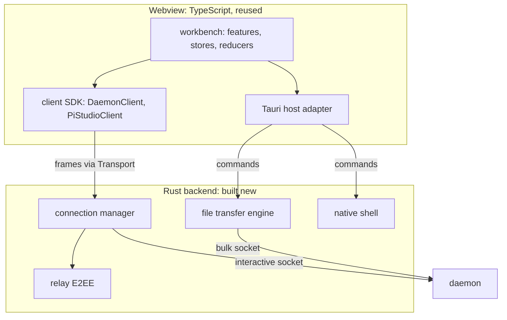

# Desktop client handoff

Onboarding notes for the agent building **Pi Studio Desktop** (`pi-studio-desktop`, a separate
repository): a Tauri app with a Rust backend and a web UI. This document says what to reuse from
this repository, what to build in Rust, and why.

Written 2026-11-14 against pi-studio `0.0.117`. Everything under "exists today" was checked against
the code at that version. Anything marked **planned** or **unverified** was not.

**This document is kept current.** The work it describes as planned is being built in this
repository now, and every task in that plan must update this file when it changes something
stated here. "Plan and progress" below shows how far that work has got. Last updated: 2026-11-14
(sprint 094 done on `feat/workbench`: `packages/workbench` builds a publishable library with its
final public API and README, proven by a packed-tarball consumer; not published yet — sprint 095).

## Status of the pieces

| Piece | State |
|---|---|
| `@av-pi-studio/protocol`, `client`, `relay` | Published on npm, in use |
| `@av-pi-studio/ui-library` (tokens, themes, primitives) | Published on npm since `0.0.117` |
| Workbench package `@av-pi-studio/workbench` | **Planned, not built** (sprints 091–095, see "Plan and progress"). Specified in `swe/architecture/workbench-package.md` and `swe/architecture/workbench-host-adapter.md`. Section "The workbench" describes the intended contract, not an API you can import today. Read its README once it exists and trust that over this document |
| Protocol follow-ups for this client | **Planned, not built** (sprint 096). `swe/features/desktop-client-protocol-followups.md`: a `platform` field in the handshake, paced uploads and downloads with a completion signal, and fixtures for file transfer and terminals |
| `pi-studio-desktop` | Scaffold only (one commit, from the `av-rust-desktop` template). It still holds the template's sample checklist app |
| `pi-studio-dashboard` | A sibling Tauri app (read-only monitor). Its Rust `protocol` and `client` crates already speak the daemon protocol |

## Plan and progress

This document is updated by every task that changes something it states. The table is the quick
way to see what you can rely on today. Plan of record: `swe/sprints/PLAN.md`.

| Sprint | Delivers | What it unlocks for the desktop app | State |
|---|---|---|---|
| 091 | Packaging spike, empty `@av-pi-studio/workbench` | Nothing yet | **Done** (on `feat/workbench`; findings in `swe/notes/workbench-packaging-spike.md`) |
| 092 | Application code moved into the workbench; `electron` target removed | Nothing yet (not published) | **Done** (parity: identical bundle, tests, browser check — `swe/notes/workbench-baseline.md`) |
| 093 | Host adapter: storage, clipboard, dialogs, links, launch, transport factory, timers, files, pdf.js | The seam a Tauri host implements | **Done** (contract in `packages/workbench/src/host/types.ts`; a test fails if browser APIs reappear outside the browser host) |
| 094 | Published build, public API, packed-tarball smoke, package README | An importable package and its real API | **Done** (API and host contract: `packages/workbench/README.md`; `scripts/pack-smoke.sh` installs the tarballs into a scratch Vite app) |
| 095 | Release wiring; first npm release of the workbench | **Milestone 1 can start** | Not started |
| 096 | `hello.platform`, paced transfers, upload acknowledgement, file and terminal fixtures (JSON and binary) | A pinned wire contract for the Rust transfer engine (milestone 3) | Not started |

Milestone 2 (the Rust transport bridge) depends only on the existing `Transport` interface and the
published SDK. It can be prototyped before sprint 095, against `web-client`'s behaviour, but it
cannot be wired into the UI until the workbench is published.

## The decision in one paragraph

Reuse the entire UI from this repository and rebuild only the data plane in Rust. The composer,
timeline, split panes, terminal panel, file explorer, viewers and settings stay in TypeScript and
arrive as an npm package. Rust owns the things a browser does badly or cannot do: the sockets, file
transfer to and from disk, relay encryption, and the native shell (daemon supervision, keychain,
menus, notifications, updates).

The goals behind the desktop app are a native client, no browser transfer limits, stable networking
and better performance. The limits that motivate it sit in the browser sandbox and in the transfer
code of the TypeScript SDK, not in the React components. Rewriting components in a different
architecture would cost months and fix none of them.

## System context

Pi Studio is a client/daemon system. The **daemon** is a Node.js process (`packages/server`) that
runs agents, terminals, git and file operations on the developer's machine and exposes one
WebSocket API. Every client, including the desktop app, is a client of that daemon. The desktop
app does not replace the daemon and does not run agents itself.

- One WebSocket per client. Text frames carry JSON envelopes; binary frames carry terminal and
  file-transfer data with a 2-byte header `[opcode][slot]`.
- Direct connection: `ws://` or `wss://` to the daemon (default `127.0.0.1:6767`).
- Relay connection: both sides dial a relay; traffic is end-to-end encrypted.
- The protocol is append-only. Capabilities are discovered from `server_info.features` after the
  handshake; a client must gate features on those flags, never on a version number.
- Two daemons exist for development. `npm start` runs the production daemon (real Pi provider,
  every RPC). `npm run dev:daemon` runs a dev daemon with a mock provider and a minimal handler
  set: it has **no terminal and no file-transfer handlers** today (sprint 096 adds them). Test
  those two areas against a production daemon until then.

Read the root `AGENTS.md` § Protocol overview first. It is the best single summary.

## Architecture



The seam between the two halves is narrow on purpose: one interface for socket frames
(`Transport`, exists today) and one for platform services (the host adapter, planned).

## What to reuse

### Packages

| Package | What it gives you | Notes |
|---|---|---|
| `@av-pi-studio/protocol` | Zod schemas, binary frame codecs, capability flags | Also ships `fixtures/external-clients/`, the wire contract for non-TypeScript clients |
| `@av-pi-studio/client` | `DaemonClient` (handshake, RPC correlation, liveness), `PiStudioClient` facade, `ReconnectionManager`, file transfer and terminal routers | The webview keeps using this |
| `@av-pi-studio/relay` | Relay E2EE channel primitives (TypeScript) | Reference implementation for the Rust port |
| `@av-pi-studio/ui-library` | Design tokens, six themes, primitives, `styles.css`, `reset.css` | See `packages/ui-library/README.md` and `DESIGN_SYSTEM.md` |
| Workbench (**planned**) | The application: every feature, its stores and its reducers | See below |

All packages are versioned in lockstep and every push to `main` publishes a release, so pin exact
versions in the desktop repository and upgrade deliberately.

### The workbench (planned)

At 0.0.117 `packages/web-client` was an application, not a library: it published only a built
`dist` and had no `exports`. About 31k lines in 227 files; the browser-specific shell (`main.tsx`,
`app.tsx`, `AppProviders.tsx`, `WorkspacePage.tsx`) was 138 of them. On `feat/workbench` the
application code now lives in `packages/workbench/src` (sprint 092; same relative paths, so the
paths in the host table below are relative to that directory). Not published yet. What moved:

- `features/`: chat (composer, timeline, attachments, todos), workspace (split panes, tab strips),
  terminal, files (explorer and viewers), sessions, settings, skills, provider auth, extension UI.
- `stores/`, `hooks/`, `timeline/`, `lib/`, `viewer-plugins/`.

Intended shape:

- A whole-app entry (one component plus a host object) so the desktop app renders the full UI on
  day one.
- Feature-level entries for when the desktop app wants its own layout.
- A **host adapter**: one object the embedding shell supplies. `web-client` implements it with
  browser APIs; the desktop app implements it with Tauri calls.

The host adapter has to cover the browser-bound code that exists in `web-client` today. This list
is the checked inventory; the adapter's real method names will be in the workbench README.

Built in sprint 093 (`packages/workbench/src/host/`, contract in
`swe/architecture/workbench-host-adapter.md`; the types are in `src/host/types.ts`, and
`src/test/test-host.ts` is an in-memory recording host worth copying for your own tests). Members: `app` (`{title,
version}` for the connection bar), `storage` (a **synchronous** key/value store: if your Tauri
storage is asynchronous, load it into memory before the first render and write behind),
`clipboard.writeText`, `dialogs.confirm/alert/prompt` (all promise-returning, so native Tauri
dialogs fit directly), an optional `links.openExternal(url)` (when present, every external link
in the app calls it instead of navigating), `files` (`upload(dir, source)`, `saveToDisk(path)`,
`openForView(path)` → `{url, mimeType?, fileName?, release()}`, optional `pickUploads()`; every
viewer, inline chat image and "Download" button goes through these, so a Rust host can stream to
disk and serve viewer URLs from a custom protocol; an `UploadSource` is `{name, size?}`, and you must
also accept a browser `File`, which the molecule viewer uploads for generated structures), `launch` (`initialConnect()` returns a `ConnectIntent`
— `{url?, password?, cwd?, connect}`, `url` may be a pairing link — or `null` to show the
connection fields; `agentDeepLink.{current, subscribe, consume}` is where an OS deep link to an
agent goes) and `connection`: `createTransport(target, {password})` returns the `Transport` the
SDK's `DaemonClient` uses for one connect (`target` is `{mode: "direct", url}` or `{mode: "relay",
url, daemonPublicKey}`; return `undefined` for the SDK's own WebSocket; a throw fails that connect
with your message), `timers` (passed to `ReconnectionManager`; must keep firing while the window
is hidden) and `onResume(listener)` (fire it on wake, focus or network change; the workbench
decides whether to probe or reconnect). This is milestone 2's seam. One optional member, `pdf`
(`createWorker()` returning a pdf.js worker built from **the same `pdfjs-dist` version** as the
workbench's, and `assetBaseUrl` where pdf.js's `cmaps/`, `standard_fonts/`, `wasm/` and `iccs/`
are served — the workbench's `@av-pi-studio/workbench/vite` export, `pdfjsAssetsPlugin()`, serves
and emits them for a Vite build); without it PDFs
show an error state with Download. The host is installed by
`<Workbench host={…}>` / `<WorkbenchProvider host={…}>` on first render; the first host wins.

Status of each row below: moved behind the host = the browser code now lives in
`packages/workbench/src/host/browser-*.ts`.

| Concern | Where it lived at 0.0.117 | Status |
|---|---|---|
| Socket creation, password subprotocol, relay vs direct | `lib/connection/connection-store.ts` | Moved behind `connection.createTransport` |
| Persistent key/value storage (`localStorage`) | `lib/pane-layout-persistence.ts`, `stores/layout-store.ts`, `features/chat/todos/`, `viewer-plugins/viewer-settings-store.ts`, `features/files/html-sandbox.ts` | Moved behind `storage` |
| Clipboard | `lib/clipboard.ts` | Moved behind `clipboard` |
| Location and deep links (`#agent=<id>`) | `hooks/use-connection.ts`, `hooks/use-agent-deep-link-boot.ts`, `features/sessions/apply-agent-deep-link.ts` | Moved behind `launch` |
| Opening an external URL | `features/provider-auth/LoginDialog.tsx` | Moved behind `links` |
| File upload and download | `hooks/use-file-transfer.ts`, `hooks/use-file-download.ts` | Moved behind `files` (viewers, inline chat images, every "Download" action) |
| Reconnect timers and resume triggers | `lib/connection/worker-timers.ts`, `lib/connection/resume-triggers.ts` | Moved behind `connection.timers` / `connection.onResume` |

Constraints to know before consuming it:

- **State lives in module-level zustand stores** (16 of them). One workbench instance per webview.
  Two windows do not share memory; they converge through the daemon, which already broadcasts
  state changes to every session.
- **It needs a bundler that understands it.** There are lazy chunks (viewers, settings panels,
  markdown), a pdf.js module worker, and pdf.js data files that `web-client`'s Vite config serves
  from `node_modules`. Expect to consume it with Vite 6 and `@vitejs/plugin-react` 4. The packaging
  spike (`swe/notes/workbench-packaging-spike.md`) showed a plain Vite consumer of a package built
  this way needs no `optimizeDeps` setting; third-party stylesheets (katex) and the terminal font
  arrive as bare imports and plain files, which your bundler emits.
- **React 19.** `ui-library` declares `react` and `react-dom` `^19.0.0` as peer dependencies.

## What to build in Rust

In priority order. Each step leaves a working app.

### 1. Connection manager and transport bridge

`DaemonClient` accepts an injected transport (`packages/client/src/transport.ts`):

```ts
export interface Transport {
  connect(url: string): Promise<void>; // resolves when the socket is open, before the handshake
  sendText(data: string): void;
  sendBinary(data: Uint8Array): void;
  close(code?: number, reason?: string): void;
  readonly isOpen: boolean;
  onMessage: ((data: string | ArrayBuffer | Blob) => void) | null;
  onClose: ((code: number, reason: string) => void) | null;
  onError: ((error: unknown) => void) | null;
}
```

Implement this in the webview as a thin wrapper over Tauri IPC, with Rust holding the real socket.
The relay transport already uses the same seam, so nothing above it changes.

What stays in TypeScript at this level: the `hello` handshake, RPC correlation, JSON `ping`/`pong`
liveness and `ReconnectionManager`. Rust owns the TCP and TLS connection only. That is deliberate
for the first version: it changes no store and no reducer.

Rules the bridge must honour:

- **Deliver frames in wire order, binary as `ArrayBuffer`, synchronously.** `transport.ts`
  documents a real bug where out-of-order binary delivery truncated downloads.
- **Authentication.** A password-protected daemon requires the WebSocket subprotocol
  `pi-studio.bearer.<password>` on the upgrade (`packages/server/src/auth/password-auth.ts`). Keep
  the password in the OS keychain and attach it in Rust; it should not need to live in the webview.
- **Host header.** The daemon validates `Host` against `PI_STUDIO_HOSTNAMES` (default
  `localhost,*.localhost`). The WebSocket upgrade does not check `Origin`.
- **Client type.** `hello.clientType` is an enum of `mobile`, `browser`, `cli`, `mcp`. Send
  `browser`: a daemon rejects an unknown value, and on a relay connection it does so silently.
  The follow-ups spec adds an optional `hello.platform` string (`"desktop"`), which every daemon
  accepts; send it once it exists.
- **Timers.** `ReconnectionManager` takes injected `setTimer`/`clearTimer`. `web-client` passes
  Web Worker timers to survive hidden-tab throttling. Supply timers from Rust, or have Rust signal
  "socket closed", "network back" and "system woke" so the webview reconnects at once.

What this buys: no dependency on webview timer throttling, TCP keepalive, sleep/wake awareness,
native TLS and certificate handling, and the password out of the webview.

Start from `pi-studio-dashboard`'s `crates/protocol` (frames, handshake, lenient decoding, about
1.9k lines) and `crates/client` (tokio-tungstenite, backoff, liveness, TLS, secrets, about 2.6k
lines). Share them between the two repositories instead of copying. Whether they already handle
binary frames and the relay was **not verified**.

Moving the session itself (handshake, reconnect, resubscription) into Rust is a possible later
step. It needs SDK changes and should wait for a measured reason.

### 2. File transfer engine

How transfers work today, and why they hit limits:

| Today | Consequence |
|---|---|
| Upload reads the whole file with `file.arrayBuffer()`, then queues every chunk at once with no backpressure (the browser host's `files.upload`, `file-transfer-client.ts`) | Memory use is at least the file size; large files stall or crash the tab |
| Download collects chunks in an array, concatenates them, then copies into a `Blob` (`file-transfer-client.ts`, the browser host's `files.openForView`/`saveToDisk`) | Two to three copies of the file in memory |
| Transfers share the one WebSocket with RPC and terminal data | A large transfer delays chat and terminal frames |
| Text viewers stop at 30 MiB; inline reads stop at 5 MiB (`MAX_INLINE_FILE_READ_BYTES`) | Large files cannot be previewed |

The wire flow (`swe/features/file-explorer-transfer.md`,
`packages/protocol/src/binary-frames/file-transfer-protocol.ts`,
`packages/server/src/files/file-transfer.ts`):

- **Download:** `file_download_token_request`, then `file_download_request`, then binary frames
  `Begin` (0x10), `Chunk` (0x11)…, `End` (0x12) or `Error` (0x13). Tokens are single-use with a
  10-minute cleanup TTL.
- **Upload:** `file_upload_request {path, transferId}` answers `{ok, stream}`; the client then
  sends `Begin` (with `transferId`), `Chunk`…, `End`. The daemon writes to the target path.
- Chunks are 32 KiB. Stream ids are one byte (256), allocated by the daemon across all sessions.
- No upload size cap was found in the daemon; the ceiling today is client memory.
- **An upload has no completion signal today.** The daemon sends nothing after `End`, and a write
  error on the daemon is not reported to the client. Neither side applies flow control. The
  follow-ups spec adds an opt-in `file_upload_complete` push and pacing; until it ships, verify an
  upload by listing the target directory.
- On a download read error the daemon sends `Error` and then still sends `End`. Treat `Error` as
  final.

Recommended design:

- Open a **second daemon connection owned entirely by Rust** for bulk transfers. It needs its own
  handshake, so it removes the head-of-line blocking and avoids multiplexing two writers onto the
  interactive socket. Over the relay this means a second encrypted channel; **unverified** that the
  relay accepts two channels for one daemon from the same client.
- Upload by local path and download to a local path, streaming with backpressure. The bytes never
  enter the webview. Native drag-and-drop yields real paths, which fits directly.
- Expose progress and cancel to the webview through the host adapter.
- Give viewers a native URL (a custom protocol served by Rust) instead of a `Blob` object URL, so
  images, video and PDFs stream and support range requests.

Limits a client cannot remove alone, because they are in the protocol: there is **no resume** after
a dropped connection, and the chunk size is fixed at 32 KiB. If those matter, raise them in this
repository; a daemon-side fix helps every client.

### 3. Relay E2EE

`packages/relay/src/channel.ts` and `packages/client/src/relay-transport.ts` are the reference.
Specification: `swe/architecture/relay-e2ee.md`.

- The client generates a fresh ephemeral Curve25519 keypair per connection and sends
  `e2ee_hello {ephemeralPublicKey}`; the daemon answers `e2ee_ready`.
- Shared key: Curve25519 ECDH (NaCl `box.before`).
- Each message: `base64(24-byte random nonce ++ box(plaintext))`, XSalsa20-Poly1305.
- Binary application frames travel as `e2ee_bin`, a JSON text frame carrying base64 ciphertext.
  The relay never sees a raw binary WebSocket frame.
- The relay session id derives from the daemon's public key (`deriveRelaySessionId`), which comes
  from the pairing link (`pi-studio daemon pair`).

In Rust this is a second implementation of the same `Transport` contract, invisible to the webview.
It moves the per-frame encryption and base64 off the JavaScript main thread. Both source files
carry `TODO(verify)` notes on the registration frame and on in-session replay protection; read them
before porting.

### 4. Native shell

- **Local daemon.** `pi-studio daemon start` (npm `@av-pi-studio/cli`, Node ≥ 22.20) starts a
  daemon or finds the running one through a PID lock. Whether the desktop app bundles Node or
  expects an installed CLI is an open product decision. See `packages/cli/AGENTS.md`.
- Connection profiles, with secrets in the OS keychain.
- Native menus, notifications, auto-update, file dialogs, OS-level deep links.

## What not to bring over

These exist only to work around the browser. Replace them through the host adapter:

- The browser's worker-backed timers and `visibilitychange`/`online` resume triggers (now the
  workbench's `host/browser-worker-timers.ts` and `host/browser-connection.ts`).
- `lib/connection/normalize-url.ts` and the `/daemon-ws` same-origin proxy path.
- `#agent=<id>` URL deep links.
- The in-memory download path and `Blob` object URLs for file viewers.

## Rules in the desktop scaffold that must change

The `av-rust-desktop` template assumes the application's state lives in Rust. This design keeps
view state in TypeScript, so the scaffold's own `AGENTS.md` needs editing before work starts:

- **Golden rule 1** ("the frontend is thin… no business logic, no document state and no file or
  network access in TypeScript") no longer holds for view state. Suggested replacement: the
  frontend owns view state and talks to the daemon through the SDK; Rust owns sockets, files on
  disk, secrets and OS integration.
- **Golden rule 6** ("the webview may call the app's two commands and listen for one event") is
  too narrow for a transport bridge and a host adapter.
- **CSP.** `tauri.conf.json` allows `connect-src ipc: http://ipc.localhost` only. That is correct
  if every socket goes through Rust. It must also allow whatever the workbench needs for workers
  and the native file URL scheme.
- The template's `doc`, `ops` and `format` crates (document model, undo history, file format) are
  the sample app. This client has no document to save; remove or repurpose them.
- Rules worth keeping as they are: never crash, layering enforced by `cargo xtask layers`, tests
  as the gate, permissive licences only.

## Performance expectations

- **Rendering does not get faster by moving to Tauri.** The UI still runs in a system webview
  (WebKitGTK on Linux, WKWebView on macOS, WebView2 on Windows). WebKitGTK may well be slower than
  Chrome; this was **not measured**. Measure on all three before promising anything.
- **UI speed-ups belong in the workbench**, where the browser client gets them too. One known
  example: the terminal uses xterm.js's DOM renderer, with no canvas or WebGL addon loaded
  (`features/terminal/TerminalPanel.tsx`).
- **The daemon is still Node.** Agent, git and file operations are bounded by it.
- **Measure the IPC bridge.** Terminal output and token streams will cross Tauri IPC. Send binary
  payloads as raw bytes, not JSON arrays, and benchmark a busy terminal before committing to the
  bridge for all traffic. A direct WebSocket from the webview is the fallback for interactive
  traffic if the bridge is too slow.

## Compatibility rules

- The wire protocol is append-only. New optional fields appear; fields are never removed or
  narrowed. Decode leniently and ignore unknown fields and unknown message types.
- Gate every feature on `server_info.features`.
- `packages/protocol/fixtures/external-clients/` holds one canonical JSON frame per message an
  external client uses (60 entries, `formatVersion` 1). Vendor it and deserialize every fixture in
  Rust tests. Its README explains the format and the breaking-change policy.
- The fixtures do **not** cover file transfer or terminal messages today. The follow-ups spec adds
  them, including binary frames. Do not let the Rust transfer engine depend on those shapes
  before the fixtures exist.
- `~` in a path is expanded by the daemon. Take the home directory from `server_info.homeDir`;
  never derive it locally, since the desktop app may drive a daemon on another OS.

## Suggested milestones

1. **Shell renders the workbench.** Tauri window, workbench whole-app entry, a host adapter backed
   by Tauri storage and clipboard, direct WebSocket from the webview. Proves packaging and CSP.
2. **Rust transport bridge.** Sockets move to Rust; password in the keychain; reconnect driven by
   native signals. Check: sleep the machine, wake it, and the session recovers without a reload.
3. **Transfer engine.** Upload and download by path on the bulk connection. Check: a multi-gigabyte
   file moves both ways with flat memory use while a terminal stays responsive.
4. **Relay in Rust.** Check: a paired remote daemon works with the same behaviour as direct.
5. **Native shell features.** Daemon supervision, menus, notifications, updates.

## Open questions

- Does the desktop app bundle a daemon, or only connect to existing ones?
- Do the dashboard's Rust crates move to a shared repository or a published crate?
- Does the relay accept a second channel from the same client for the bulk connection?
- Should the protocol gain transfer resume and a larger chunk size? Both are out of scope for the
  follow-ups spec.
- Is ordered, low-overhead binary delivery over Tauri IPC fast enough for terminal traffic?

## Where to read next

| Topic | File |
|---|---|
| Whole-system orientation | `AGENTS.md` (root) |
| WebSocket protocol | `swe/architecture/websocket-protocol.md` |
| Client runtime layers | `swe/architecture/client-app-runtime.md` |
| Relay E2EE | `swe/architecture/relay-e2ee.md` |
| External-client fixtures | `swe/architecture/external-client-fixtures.md`, `packages/protocol/fixtures/external-clients/README.md` |
| File transfer | `swe/features/file-explorer-transfer.md` |
| Terminals | `swe/features/terminals.md` |
| Reconnect behaviour | `swe/features/connection-resilience.md` |
| Stream events | `docs/agent-stream-events.md` |
| SDK | `packages/client/AGENTS.md` |
| Design system | `packages/ui-library/README.md`, `packages/ui-library/DESIGN_SYSTEM.md` |
| Current web UI invariants | `packages/web-client/AGENTS.md` |
| Sibling Rust client | `pi-studio-dashboard`: `docs/architecture.md`, `crates/protocol`, `crates/client` |
