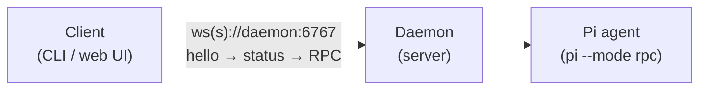
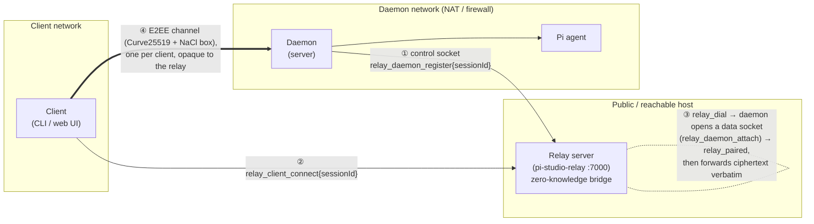

By default a client connects **directly** to the daemon's WebSocket. When the daemon can't
accept inbound connections (behind NAT, no port-forward), the `@av-pi-studio/relay` package
provides an end-to-end encrypted rendezvous: the daemon dials **outbound** to a relay, the client
connects to the same relay, and all application traffic is encrypted with Curve25519 ECDH +
XSalsa20-Poly1305 (NaCl `box`). The relay is **untrusted and zero-knowledge** — it forwards
ciphertext frames verbatim, keyed by session id, and never sees message contents, only metadata.

The relay is **fully opt-in**: with `daemon.relay.enabled` unset (default `false`), the daemon
behaves exactly as if the package weren't installed.

## Simple setup — direct connection (default, no relay)

The client reaches the daemon's WebSocket directly. Nothing extra to run.



## Scaled setup — client → relay → daemon (daemon behind NAT)

The daemon dials **outbound** to the relay (so no inbound port is needed on the daemon's
network): it keeps one control socket open and, for each client connection, opens a separate data
socket. The client dials the relay with the same `sessionId`; the relay pairs that one client
socket with one daemon data socket and blindly forwards frames, so up to **32 clients** can use one
daemon at once. The E2EE channel is established **end-to-end between client and daemon**, so the
relay never holds decryptable traffic.



Handshake order over the relay (protocol 2): the daemon registers a control socket with
`relay_daemon_register{sessionId}` → a client sends `relay_client_connect{sessionId}` → the relay
sends `relay_dial{connectionId}` on the control socket → the daemon attaches a data socket with
`relay_daemon_attach{sessionId, connectionId}` → the relay sends `relay_paired` to both. Those first
frames are JSON; **after `relay_paired` every frame is binary**: the client sends the channel
`hello` (its fresh public key), the daemon answers `ready` (a daemon salt plus an encrypted
confirmation), and all further traffic is NaCl-box ciphertext with counter nonces. Only **after**
the channel is up does the normal `hello → status → RPC` protocol run inside it. The relay refuses
a connection with a close code (4100–4109; `daemon_offline`, `daemon_unresponsive`,
`too_many_clients`, `daemon_outdated`, …) that the client SDK reports as a `RelayConnectError` with
a reason; the whole client connect is limited to 15 s. The relay applies flow control (pause above
1 MiB queued, resume at 256 KiB) and pings every socket every 30 s, so one slow client cannot make
the relay or another client's connection wait.

<Note>
  **Upgrading from relay protocol 1 (0.0.120 and earlier).** The daemon must be updated: an old
  daemon still registers with `relay_register`, the relay parks that socket, and a new client sees
  `daemon_outdated` instead of a connection. Browser tabs opened before the update stay on
  "connecting" until they are reloaded. Existing pairing links stay valid — the daemon key and the
  session id derived from it do not change. A self-hosted relay must be updated too.
</Note>

## Running a relay and pointing a daemon at it

```bash
# 1) start a relay on a reachable host (defaults to 0.0.0.0:7000)
npx @av-pi-studio/relay --listen 0.0.0.0:7000
# or via the CLI, managed as a local process:
pi-studio relay start --listen 0.0.0.0:7000
```

```bash
# 2) point the daemon at it (config.json)
#    { "daemon": { "relay": { "enabled": true, "endpoint": "relay-host:7000", "useTls": false } } }
#    or env: PI_STUDIO_RELAY_ENABLED=true PI_STUDIO_RELAY_ENDPOINT=relay-host:7000
```

The client then pairs via a pairing URL (carrying the daemon's public key and the relay session
id, printed by `pi-studio daemon start`/`daemon pair`) and swaps in the relay transport — every
other client API works unchanged.

<Warning>
  Treat a pairing link like a password. On a relay connection its `offer=` key *is* the
  credential, and the relay session id is derived from that key — so a leaked link keeps working
  until the key is replaced. Run `pi-studio daemon rotate-key` to revoke it (see
  [Daemon configuration](/configuration/daemon#passwords-and-pairing-keys)): the daemon mints a
  new keypair, restarts, and prints a fresh QR. All clients must re-pair; your password and relay
  settings are untouched.
</Warning>

## Environment variables

See the relay-related rows in [Daemon configuration](/configuration/daemon) —
`PI_STUDIO_RELAY_ENABLED`, `PI_STUDIO_RELAY_ENDPOINT`, and `PI_STUDIO_RELAY_USE_TLS`.
