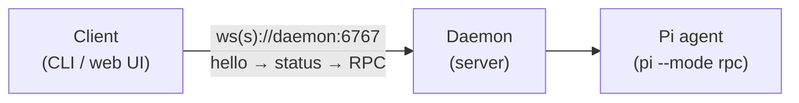
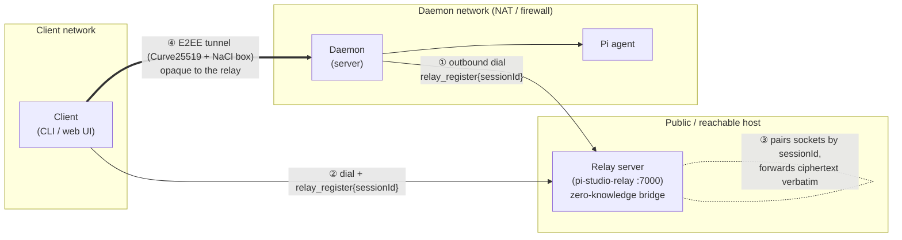

By default a client connects **directly** to the daemon's WebSocket. When the daemon can't
accept inbound connections (behind NAT, no port-forward), the `@av-pi-studio/relay` package
provides an end-to-end encrypted rendezvous: the daemon dials **outbound** to a relay, the client
connects to the same relay, and all application traffic is encrypted with Curve25519 ECDH +
XSalsa20-Poly1305 (NaCl `box`). The relay is **untrusted and zero-knowledge** — it forwards
ciphertext frames verbatim, keyed by session id, and never sees message contents, only metadata.

The relay is **fully opt-in**: with `daemon.relay.enabled` unset (default `false`), the daemon
behaves exactly as if the package weren't installed.

## Simple setup — direct connection (default, no relay)

The client reaches the daemon's WebSocket directly. Nothing extra to run.



## Scaled setup — client → relay → daemon (daemon behind NAT)

The daemon dials **outbound** to the relay (so no inbound port is needed on the daemon's
network). The client dials the relay too. Both register the same `sessionId`; the relay pairs
the two sockets and blindly forwards frames. The E2EE channel is established **end-to-end
between client and daemon**, so the relay never holds decryptable traffic.



Handshake order over the relay: both sides send `relay_register{sessionId}` → client sends
`e2ee_hello{ephemeralPublicKey}` → daemon replies `e2ee_ready` → all further traffic is
`e2ee_app{frame}` ciphertext. Only **after** the E2EE tunnel is up does the normal
`hello → status → RPC` protocol run inside it.

## Running a relay and pointing a daemon at it

```bash
# 1) start a relay on a reachable host (defaults to 0.0.0.0:7000)
npx @av-pi-studio/relay --listen 0.0.0.0:7000
# or via the CLI, managed as a local process:
pi-studio relay start --listen 0.0.0.0:7000
```

```bash
# 2) point the daemon at it (config.json)
#    { "daemon": { "relay": { "enabled": true, "endpoint": "relay-host:7000", "useTls": false } } }
#    or env: PI_STUDIO_RELAY_ENABLED=true PI_STUDIO_RELAY_ENDPOINT=relay-host:7000
```

The client then pairs via a pairing URL (carrying the daemon's public key and the relay session
id, printed by `pi-studio daemon start`/`daemon pair`) and swaps in the relay transport — every
other client API works unchanged.

<Warning>
  Treat a pairing link like a password. On a relay connection its `offer=` key *is* the
  credential, and the relay session id is derived from that key — so a leaked link keeps working
  until the key is replaced. Run `pi-studio daemon rotate-key` to revoke it (see
  [Daemon configuration](/configuration/daemon#passwords-and-pairing-keys)): the daemon mints a
  new keypair, restarts, and prints a fresh QR. All clients must re-pair; your password and relay
  settings are untouched.
</Warning>

## Environment variables

See the relay-related rows in [Daemon configuration](/configuration/daemon) —
`PI_STUDIO_RELAY_ENABLED`, `PI_STUDIO_RELAY_ENDPOINT`, and `PI_STUDIO_RELAY_USE_TLS`.
