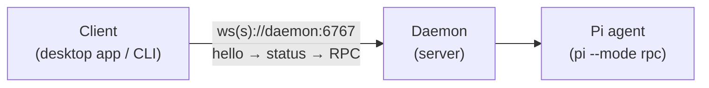

Pi-Studio drives [**Pi**](https://pi.dev) — the terminal coding agent by Earendil — locally or
remotely. A long-lived daemon runs on your machine, or on a server you own, and manages agent
processes, terminals, git worktrees, and projects. **Pi Studio Desktop**, a native app for macOS,
Linux and Windows, is the main way to use it: it runs the daemon for you and connects to daemons on
other machines. A CLI and a browser client talk to the same daemon.

**[Download Pi Studio Desktop](https://github.com/avatsaev/pi-studio/releases/latest)** for macOS
(`.dmg`), Windows (`-setup.exe`, `.msi`) or Linux (`.deb`, `.rpm`, `.AppImage`). On macOS and Linux it
downloads its own `pi-studio` daemon the first time it needs one, and it can install that daemon on an SSH
host, so there is no Node, npm or CLI to install.

The CLI is for servers, scripts and the terminal:

```bash
npm install -g @av-pi-studio/cli

pi-studio daemon start   # start (or find) a local daemon, print a pairing QR
```


## Where to go next

<CardGroup cols={2}>
  <Card title="Quickstart" href="/quickstart" icon="solid rocket">
    Install the desktop app or the CLI, log in to a model provider, and run your first agent.
  </Card>
  <Card title="CLI reference" href="/cli-reference/overview" icon="solid terminal">
    Every command group — agents, auth, daemon, and the feature groups.
  </Card>
  <Card title="Web UI" href="/web-ui" icon="solid globe">
    Chat, terminals, file diffs, and split panes — in the app, or in a browser tab.
  </Card>
  <Card title="Configuration & deployment" href="/configuration/daemon" icon="solid server">
    Daemon environment variables, the E2EE relay, and Docker.
  </Card>
</CardGroup>

## How it fits together



A single long-lived **daemon** process owns every agent, terminal, and git worktree; clients
connect to it over a WebSocket and never run agent code themselves. That's what makes a daemon on
this machine and one on a server equally first-class: the desktop app reaches either directly, over
SSH or through the relay, and a browser tab through the relay — see
[Configuration & deployment](/configuration/daemon) for reaching a daemon that isn't on
`localhost`.
