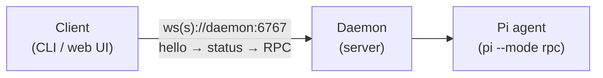

Pi-Studio drives [**Pi**](https://pi.dev) — the terminal coding agent by Earendil — locally or
remotely. A long-lived daemon runs on your machine and manages agent processes, terminals, git
worktrees, and projects. Two clients talk to it: a CLI and a full browser UI.

Your code never leaves your machine.

```bash
npm install -g @av-pi-studio/cli

pi-studio daemon start   # start (or find) a local daemon, print a pairing QR
pi-studio ui             # serve the browser UI, connected to that daemon
```


## Where to go next

<CardGroup cols={2}>
  <Card title="Quickstart" href="/quickstart" icon="solid rocket">
    Install the CLI, log in to a model provider, and run your first agent.
  </Card>
  <Card title="CLI reference" href="/cli-reference/overview" icon="solid terminal">
    Every command group — agents, auth, daemon, and the feature groups.
  </Card>
  <Card title="Web UI" href="/web-ui" icon="solid globe">
    Chat, terminals, file diffs, and split panes — all in the browser.
  </Card>
  <Card title="Configuration & deployment" href="/configuration/daemon" icon="solid server">
    Daemon environment variables, the E2EE relay, and Docker.
  </Card>
</CardGroup>

## How it fits together



A single long-lived **daemon** process owns every agent, terminal, and git worktree; clients
connect to it over a WebSocket and never run agent code themselves. That's what makes a remote
daemon and a local CLI (or a browser tab on another machine) equally first-class — see
[Configuration & deployment](/configuration/daemon) for reaching a daemon that isn't on
`localhost`.
