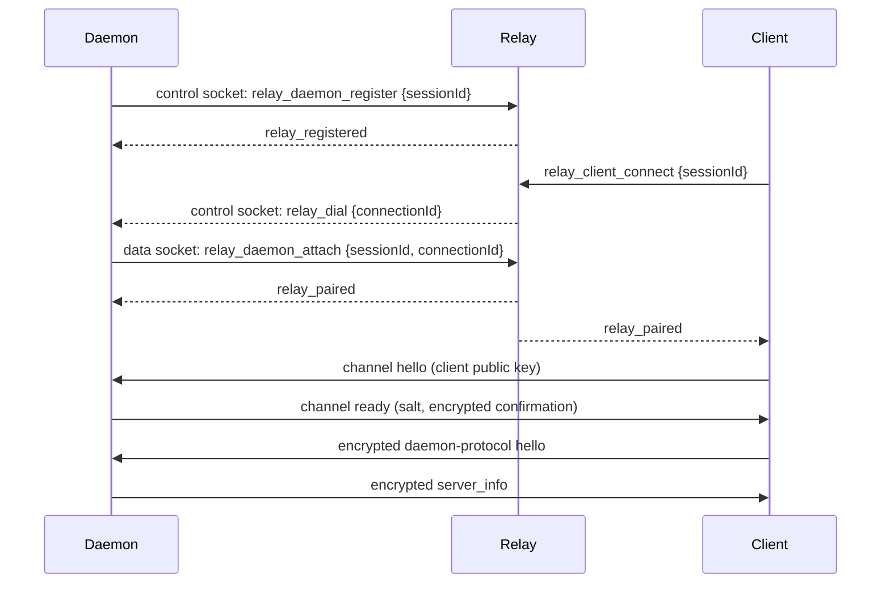

# Architecture — Relay Protocol 2

> **Status: scoped (2026-11-15), not built.** The protocol the code speaks today (0.0.120) is
> described in [relay-e2ee.md](relay-e2ee.md). This file replaces that wire format when
> [../features/relay-multi-client.md](../features/relay-multi-client.md) ships.

> Part of: [../MAIN-SCOPE.md](../MAIN-SCOPE.md)
> Dependencies: [relay-e2ee.md](relay-e2ee.md) (§ Pairing: the daemon key, the pairing link and the
> session id, all unchanged), [websocket-protocol.md](websocket-protocol.md) (the daemon protocol
> carried inside the channel), [external-client-fixtures.md](external-client-fixtures.md)
> Decisions: [../grills/relay-multi-client.md](../grills/relay-multi-client.md) (D-numbers below
> refer to it)

## Purpose

The wire contract between a daemon, a relay and a client, for every implementation: the relay
server, the daemon, the TypeScript SDK and the Rust desktop client. It has two layers.

1. **Relay control protocol.** How sockets identify themselves, how the relay pairs one client
   socket with one daemon socket, and how it refuses.
2. **Encrypted channel.** What the two paired ends send each other. The relay forwards it unread.

The relay stays untrusted. It can see addresses, timing, frame sizes, session ids and each
connection's public key. It cannot read, alter, replay, reorder or reflect application messages
without the connection closing.

## Roles and sockets

| Socket | Opened by | Lifetime | Carries |
|---|---|---|---|
| Control socket | Daemon | As long as the daemon runs with `daemon.relay.enabled` | Control frames only. One per daemon |
| Data socket | Daemon | One client connection | The encrypted channel for that client |
| Client socket | Client | One client connection | The encrypted channel |

The relay pipes exactly one client socket to exactly one data socket (D6). All three kinds dial the
same relay URL.



## Public contract

### 1. Relay control frames

Text WebSocket frames holding one JSON object. A socket's **first frame** states what it is.

| Frame | Direction | Fields | Answer |
|---|---|---|---|
| `relay_daemon_register` | daemon → relay, first frame of a control socket | `v: 2`, `sessionId` | `relay_registered` |
| `relay_registered` | relay → daemon | none | |
| `relay_client_connect` | client → relay, first frame of a client socket | `v: 2`, `sessionId` | `relay_paired`, or a close (§ 3) |
| `relay_dial` | relay → daemon, on the control socket | `connectionId` | The daemon opens a data socket |
| `relay_daemon_attach` | daemon → relay, first frame of a data socket | `v: 2`, `sessionId`, `connectionId` | `relay_paired`, or a close |
| `relay_paired` | relay → client and relay → daemon (data socket) | `connectionId` | |

- `sessionId` is `deriveRelaySessionId(daemonPublicKey)`: 32 lowercase hexadecimal characters,
  unchanged (D14).
- `connectionId` is created by the relay: 128 random bits as 32 lowercase hexadecimal characters.
  Only the daemon that received it on its control socket can attach to it.
- After `relay_paired` the relay forwards every frame between the two sockets unchanged and in
  order, text or binary, and reads none of them.
- A client sends nothing between `relay_client_connect` and `relay_paired`.
- The relay ignores a control frame of an unknown `type` on a control socket.
- **Old protocol.** A first frame `{ "type": "relay_register", … }` is the registration of 0.0.120
  and earlier. The relay keeps such a socket open and idle: it answers nothing, forwards nothing
  and ignores its later frames (D3, D16). It notes one thing about it: whether the socket has sent
  any frame since registering. An old client sends its key exchange at once; an old daemon sends
  nothing until a client reaches it, which never happens here. A parked socket that has stayed
  silent therefore counts as an outdated daemon (S9).

### 2. Limits and timers

| Name | Value | Enforced by | Meaning |
|---|---|---|---|
| Clients per daemon | 32 | relay; the daemon applies the same cap to its data sockets | Pending plus paired connections of one session id (D10) |
| Frame size | 100 MiB | relay, and the daemon on its relay sockets | Largest WebSocket message. Today's implicit limit, made explicit |
| Identify | 10 s | relay | A socket that has not sent a valid first frame is closed (D17) |
| Attach | 10 s | relay | The daemon must attach a data socket for a waiting client (D17) |
| Registration answer | 10 s | daemon | No `relay_registered`: the relay speaks an older protocol (D17) |
| Key exchange | 10 s | daemon | A paired data socket that has not received a valid channel `hello` is closed |
| Connect | 15 s | client | The whole connect: dial, pairing and key exchange (D17) |
| Ping | every 30 s | relay | WebSocket ping to every socket; a socket with two unanswered pings is closed (D17) |
| Silence | 90 s | daemon | No frame and no ping from the relay on a socket: the socket is dead (D17) |
| Redial backoff | 1 s doubling to 30 s, ±20 % jitter | daemon | Control socket only. Reset by `relay_registered` (D17) |
| Flow control | pause above 1 MiB queued, resume at or below 256 KiB | relay | Per direction of each pair (D17) |

### 3. Close codes

The reason string of the close frame is the name in this table.

| Code | Name | Sent by | When |
|---|---|---|---|
| 4100 | `protocol_error` | relay | Invalid first frame, wrong `v`, malformed `sessionId`, a client frame before `relay_paired` |
| 4101 | `identify_timeout` | relay | No first frame within 10 s |
| 4102 | `daemon_offline` | relay → client | No control socket for the session id (D7) |
| 4103 | `daemon_unresponsive` | relay → client | The daemon did not attach within 10 s |
| 4104 | `too_many_clients` | relay → client | The session id already has 32 connections |
| 4105 | `daemon_outdated` | relay → client | No control socket, but a silent old-protocol socket is parked under the session id (D3, S9) |
| 4106 | `unknown_connection` | relay → daemon data socket | The `connectionId` is not waiting: the client left, or the id is wrong |
| 4107 | `replaced` | relay → daemon control socket | A newer control socket registered the same session id |
| 4108 | `ping_timeout` | relay | Two unanswered pings |
| 4109 | `peer_closed` | relay | The other half closed with a code that cannot be forwarded |
| 4200 | `channel_error` | client or daemon | A channel frame failed (§ 4): authentication, order, format |
| 1009 | (message too big) | relay or daemon | A frame above the frame-size limit |
| 1001 | (going away) | relay | The relay is shutting down |

When one half of a pair closes, the relay closes the other half with the same code and reason if
the code may be sent by an application (1000–1003, 1007–1014, 3000–4999), otherwise with
`peer_closed`. A daemon's `1008` for an invalid daemon-protocol `hello` therefore reaches the
client as it does on a direct connection.

Codes 4100–4109 belong to the relay and 4200 to the channel. **4000 is not used here:** the
workbench already closes a connection with `4000 stale-connection-probe`
(`packages/workbench/src/lib/connection/resume-handler.ts`), and the forwarding rule above carries
that code to the daemon's data socket.

### 4. Encrypted channel

Runs between the client socket and the data socket once both have `relay_paired`. Every frame is a
**binary** WebSocket frame. A text frame after pairing is a `channel_error`.

**Keys.** NaCl `box` (Curve25519, XSalsa20-Poly1305), as today (D23). The client generates a fresh
key pair per connection. Both sides compute the same shared key from the daemon's stored key pair
and the client's fresh one (`box.before`).

**Frames.**

| Frame | Direction | Bytes |
|---|---|---|
| `hello` | client → daemon, first frame | `0x01` ‖ client public key (32) |
| `ready` | daemon → client, first frame | `0x01` ‖ salt (15) ‖ box of a `ready` record, daemon-to-client counter 0 |
| message | both, every later frame | box of a record, nothing else |

The leading `0x01` is the channel format version.

**Record** (the plaintext inside a box): one kind byte followed by the payload.

| Kind | Payload | Delivered as |
|---|---|---|
| `0x00` ready | empty | The channel is open. Valid only as the daemon's first box |
| `0x01` text | UTF-8 text: one daemon-protocol JSON envelope | A text frame of a direct connection |
| `0x02` binary | Raw bytes: one daemon-protocol binary frame | A binary frame of a direct connection |

The relay sees only ciphertext, so it cannot tell text from binary (D13). One application message
is one frame; nothing is split.

**Nonce** (24 bytes): salt (15) ‖ direction (1) ‖ counter (8, big-endian).

| Part | Value |
|---|---|
| Salt | 15 random bytes chosen by the daemon for this connection, sent in clear in `ready` |
| Direction | `0x01` client to daemon, `0x02` daemon to client |
| Counter | Starts at 0 in each direction and grows by 1 per box sent in that direction. Never on the wire |

**Rules.**

- The daemon's `ready` box uses daemon-to-client counter 0, so its next message uses 1. The
  client's first message uses client-to-daemon counter 0.
- A receiver opens each box with the next counter it expects. A box that fails to open, an unknown
  record kind, a `ready` record anywhere but first, or a malformed `hello` or `ready` frame closes
  the socket with `channel_error`. Nothing from that frame is delivered (D17, D23).
- A client sends no message before it has opened the `ready` box. Opening it proves the other end
  holds the daemon's secret key.
- A side closes the connection before a counter would wrap.

**Why the salt exists.** The shared key depends only on the daemon's long-lived key and the
client's key. A relay can record a client's `hello` and present it again on a new connection, and
the daemon would derive the same shared key. With a nonce made of direction and counter alone, the
daemon would then encrypt new plaintext under a key and nonce it had already used, which breaks the
cipher. The daemon's random salt makes every connection's nonces distinct even under a repeated
key.

### 5. What changes for the daemon protocol

Nothing. The envelopes and binary frames inside the channel are the daemon protocol of
[websocket-protocol.md](websocket-protocol.md). A relay connection has its own daemon session,
created by its `hello`, exactly like a direct connection (D8). An invalid first application frame
closes the data socket with `1008`, as on a direct connection.

## Behavior & algorithms

### Relay

```
state:
    controls: sessionId    -> control socket
    waiting:  connectionId -> { sessionId, client socket }
    pairs:    connectionId -> { sessionId, client socket, data socket }
    parked:   sessionId    -> old-protocol sockets, each marked silent until it sends a frame

on socket open:
    start the identify timer (10 s)

on first frame f:
    if f is not a text frame holding a JSON object      -> close protocol_error
    if f.type == "relay_register"                       -> park the socket under f.sessionId, silent; stop
    if f.v != 2 or f.sessionId is malformed             -> close protocol_error
    S = f.sessionId

    relay_daemon_register:
        old = controls[S]; controls[S] = socket
        send relay_registered
        if old: close old with replaced                  # its pairs are untouched (D15, D17)

    relay_client_connect:
        if no controls[S]:
            close (parked[S] has a silent socket ? daemon_outdated : daemon_offline)
        if count(waiting + pairs for S) >= 32:           close too_many_clients
        C = 128 random bits
        waiting[C] = { S, socket }
        send relay_dial { connectionId: C } on controls[S]
        start the attach timer (10 s)

    relay_daemon_attach:
        w = waiting[f.connectionId]
        if w is missing or w.sessionId != S:             close unknown_connection
        move w to pairs with this socket as the data socket
        send relay_paired { connectionId } to both sockets
        start piping

    anything else:                                       close protocol_error

piping (each direction, from a to b):
    forward every frame from a to b unchanged, text or binary, in order
    when b has more than 1 MiB queued: stop reading from a
    when b is back at or below 256 KiB: read from a again

on attach timer:          close the waiting client with daemon_unresponsive; forget the entry
on a waiting client closing: forget the entry           # a late data socket gets unknown_connection
on one half of a pair closing:
    close the other half (same code and reason when forwardable, else peer_closed)
    log one summary line (features/relay-multi-client.md § Observability)
on a control socket closing:
    if it is still controls[S]: delete controls[S]       # waiting entries and pairs stay
on a later frame from a parked socket:
    mark it not silent; ignore the frame
every 30 s:
    ping every socket, parked ones included; close with ping_timeout after two unanswered pings
on shutdown:
    close every socket with 1001
```

### Daemon

```
control loop:
    dial the relay; send relay_daemon_register { v: 2, sessionId }
    no relay_registered within 10 s:
        log that the relay must be updated; close; back off; retry
    on relay_registered: reset the backoff
    on relay_dial { connectionId }:
        if 32 data sockets are open: ignore it and log   # an untrusted relay cannot exhaust the daemon
        else open a data socket for connectionId
    on close, or 90 s without a frame or ping:
        wait the backoff delay (1, 2, 4 … 30 s, ±20 %); redial
        after close code replaced: log that another daemon uses this key; wait 30 s; redial

data socket (connectionId):
    dial the relay; send relay_daemon_attach { v: 2, sessionId, connectionId }; wait for relay_paired
    no valid channel hello within 10 s: close
    shared = box.before(client public key, daemon secret key)
    salt = 15 random bytes
    send ready
    session = none
    on a text record:
        if session is none:
            it must be a valid daemon-protocol hello, else close 1008
            session = new daemon session (transport "relay") for this socket; answer server_info
        else route it as a direct text frame
    on a binary record:
        if session exists: route it as a direct binary frame
    on close, or 90 s without a frame or ping:
        dispose this session only: its subscriptions, transfers and terminal attachments
```

The session's socket reports the data socket's queued bytes and state, and closing the session
closes the data socket. The daemon's download pacing therefore works on relay sessions without
change (D1, D6).

### Client

```
connect(relay url), failing after 15 s:
    dial the relay; send relay_client_connect { v: 2, sessionId }
    wait for relay_paired          # a close here fails the connect with that close reason
    generate a fresh key pair
    shared = box.before(daemon public key, fresh secret key)
    send hello
    wait for ready
    open its box with nonce(salt, 0x02, 0)
        fails, or is not a ready record: close channel_error; fail the connect (wrong_key)
    the transport is open
```

### Channel (both sides)

```
send(kind, payload):
    frame = box(kind ‖ payload, nonce(salt, my direction, sent))
    sent = sent + 1
    write frame as one binary WebSocket frame

on frame:
    plain = box_open(frame, nonce(salt, peer direction, received))
    if it fails:               close channel_error; deliver nothing
    received = received + 1
    deliver by record kind
```

## Data & persistence touchpoints

- The relay persists nothing. Its tables are in memory; a restart drops every socket (D13).
- The daemon adds no stored data. `$PI_STUDIO_HOME/daemon-keypair.json`, the pairing link and
  `deriveRelaySessionId` are unchanged (D14).
- `daemon.relay.*` configuration is unchanged (D13).

## Error handling & edge cases

| Condition | Expected behavior |
|---|---|
| A client asks for a session id with no control socket | Closed at once with `daemon_offline` (D7) |
| The daemon's key was replaced and a client uses an old link | `daemon_offline`: the relay cannot tell a replaced key from an offline daemon (D17) |
| A 33rd client asks for a daemon with 32 connections | `too_many_clients`; after one leaves, the next is accepted (D10) |
| The daemon does not attach within 10 s | The client is closed with `daemon_unresponsive` (D17) |
| The client leaves before the data socket arrives | The data socket is closed with `unknown_connection` (D17) |
| The control socket drops while clients are connected | Pairs keep running. New clients get `daemon_offline` until the daemon registers again (D15) |
| The control socket drops while a client is waiting | The client keeps waiting for its 10 s; a daemon that already received the dial can still attach |
| A second daemon registers the same session id | It becomes the control socket; the older one is closed with `replaced`; pairs continue (D17) |
| Someone who holds the pairing link registers as the daemon | Possible, by the previous row. Accepted: a link holder already has full access (D17) |
| A socket goes silent without closing | The relay closes it after two unanswered pings. The daemon closes a socket that heard nothing for 90 s and redials its control socket (D17) |
| The relay is unreachable or the control socket closes | The daemon redials with backoff, never in a tight loop (D17) |
| The relay restarts | Every socket drops. Daemons register again; clients reconnect through their reconnect loop (D17) |
| An updated daemon dials an outdated relay | No `relay_registered` within 10 s: the daemon logs that the relay must be updated and retries with backoff (D17) |
| An updated client dials an outdated relay | Nothing answers; the connect fails after 15 s |
| An old-protocol daemon is connected | It is parked: open, idle, pinged, and silent. A client asking for its session id gets `daemon_outdated` (D3, S9) |
| An old-protocol browser tab is connected | It is parked and stays on "connecting" until reloaded (D16). It sent its key exchange after registering, so it is not silent |
| Only a stale tab is parked, and the updated daemon is offline | A new client gets `daemon_offline`: the tab is not silent, so it is not taken for a daemon (S9) |
| An old client registers and its key exchange has not arrived yet | For that instant it reads as an outdated daemon. Accepted: the window is one frame long |
| The receiver is slower than the sender | The relay stops reading the sender above 1 MiB queued and resumes at 256 KiB (D17) |
| A frame above 100 MiB | The receiving side closes with `1009` (D13) |
| A frame is modified, replayed, dropped, reordered or sent back to its sender | Its box does not open with the expected counter: `channel_error`, nothing delivered (D17, D23) |
| The relay replays a recorded channel `hello` on a new connection | The daemon answers with a new salt. The relay cannot produce a valid message, and no key and nonce pair repeats |
| A client holds the wrong daemon key | The `ready` box does not open: the client closes with `channel_error` and the connect fails |
| A text frame arrives after pairing | `channel_error` |
| The relay asks the daemon to dial more than 32 connections | The daemon ignores the extra dials |
| The first application message is not a valid daemon-protocol `hello` | The daemon closes the data socket with `1008`; the relay forwards the code to the client |

## Dependencies on other specs

- [relay-e2ee.md](relay-e2ee.md): § Pairing and § Data & Persistence stay authoritative. Its
  handshake frames, app traffic frames and connection setup are replaced by this file.
- [websocket-protocol.md](websocket-protocol.md): the daemon protocol carried inside the channel.
- [external-client-fixtures.md](external-client-fixtures.md): the fixed-key fixtures that pin § 1,
  § 3 and § 4 (D11).
- [../features/relay-multi-client.md](../features/relay-multi-client.md): what changes in each
  package, the rollout and the acceptance criteria of the feature.

## Acceptance criteria

Conformance of the wire. The feature's own criteria are in
[../features/relay-multi-client.md](../features/relay-multi-client.md).

- [ ] Each control frame has the fields of § 1, and the relay answers each first frame as the
      table says.
- [ ] Each close code of § 3 is sent for its condition, with its name as the reason.
- [ ] A close with a forwardable code on one half reaches the other half with the same code and
      reason; an unforwardable one arrives as `peer_closed`.
- [ ] The `hello`, `ready` and message frames have the byte layout of § 4, and the nonce is
      salt ‖ direction ‖ big-endian counter.
- [ ] Two connections from clients that send the same channel `hello` get different salts.
- [ ] A box replayed, reordered, dropped or returned to its sender closes the connection with
      `channel_error` and delivers nothing.
- [ ] No message is accepted by a client before the `ready` box opened, or by a daemon before a
      valid channel `hello`.
- [ ] The relay forwards binary and text frames unchanged and in order, and never parses a frame
      after `relay_paired`.
- [ ] With a receiver that stops reading, the relay stops reading the sender once 1 MiB is queued,
      and reads again at 256 KiB.
- [ ] Every timer of § 2 fires at its value (tests inject shorter values).
- [ ] The daemon ignores `relay_dial` while it has 32 data sockets, and closes a data socket with
      no valid channel `hello` after 10 s.
- [ ] A first frame `relay_register` parks the socket: no answer, nothing forwarded, pings sent.
- [ ] With only a silent parked socket under a session id, a client gets `daemon_outdated`; once
      that socket has sent a frame, a client gets `daemon_offline`.
- [ ] No close code of this protocol is 4000, and a client's `4000` close reaches the daemon's
      data socket unchanged.

## TODO(verify)

- **Frame-size limit: 100 MiB, confirmed by the owner on 2026-11-15, not measured.** It is today's
  implicit limit (neither the relay nor the daemon sets one, so the WebSocket library's default
  applies), made explicit. No smaller figure can be justified from the code: image attachments in a
  prompt and timeline pages (200 items, item text unbounded) have no size bound. No measurement was
  possible: the daemon home on the scoping machine holds almost no sessions. Lower it only with a
  measurement of real message sizes.
- **Telling an old daemon from an old tab (S9)** rests on one behaviour read in the 0.0.120 code,
  not run against a live relay: the old client sends `e2ee_hello` as soon as it has registered
  (`createClientChannel`), and the old daemon sends nothing until a client's hello arrives
  (`createDaemonChannel`).
- **Channel format version.** A future change to the leading version byte must consider that the
  relay can alter it in `hello`: nothing authenticates the choice of version.
- **Pong behaviour of old clients.** Browsers answer WebSocket pings on their own; that the
  0.0.120 daemon's socket library does too was read from its documentation, not run.
- **Rust.** `crypto_box` 0.9.1 (Apache-2.0 OR MIT) was run against `tweetnacl` 1.0.3 on 2026-11-15
  with this nonce and record layout: three boxes opened, three sealed byte-identical, a wrong
  counter rejected. That was a throwaway test; the desktop repository needs its own against the
  fixtures.
